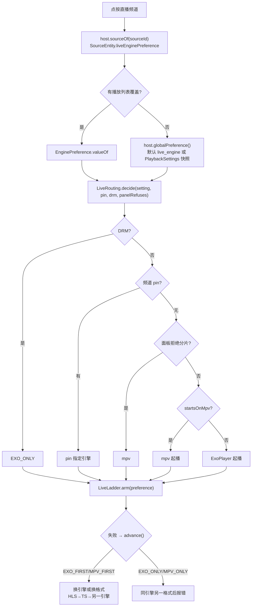
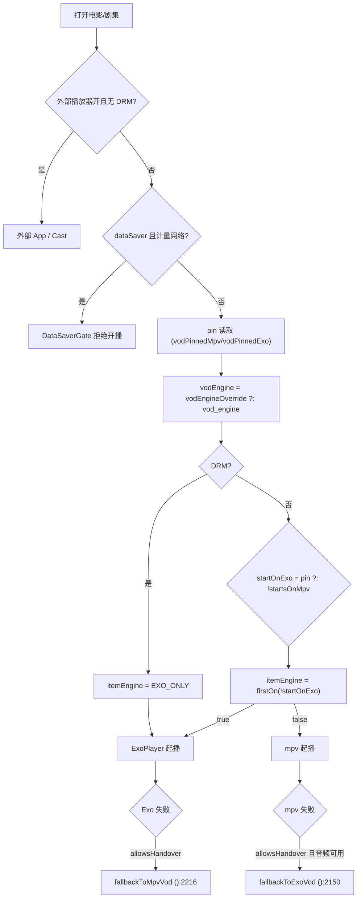

# OwnTV Mobile 设置页改造方案

| 项目 | 内容 |
|---|---|
| 仓库 | `D:\AndroidStudioProjects\git\OwnTV_Mobile`（本次只读勘查，未改业务代码、未提交、未切分支） |
| 分支 / 基线 | `mobile-mini` / `f0118cd`（2026-11-05，工作区含未提交改动，本次未触碰） |
| 依赖 | `tv.own.owntv:core` 与 `tv.own.owntv:player-core` **1.0.69**（Maven 制品，`gradle/libs.versions.toml:61-77`） |
| Core 源码 | `D:\AndroidStudioProjects\git\OwnTV_Core`（本地检出 **1.0.70**，`build.gradle.kts:14`）；`settings.gradle.kts:42-48` 含 `:core` 与 `:player-core` |
| 文档性质 | 只出方案，不含实施 |
| 适用端 | 本仓库只有手机端（`applicationId = tv.own.owntv.mobile`，无 LEANBACK）。TV 场景结论为产品建议，真机验证需在 TV 仓库执行 |

> 版本关系：本仓库编译时锁 `1.0.69`，本地 core 检出是 `1.0.70`。本文所有 core 行号来自本地 `1.0.70`；凡本仓库源码已经在用的 core 符号（`LiveTuneController`、`LiveTuneController.CoreHost`、`Host`、`play(... vodEngineOverride ...)`），可证明 `1.0.69` 制品里同样存在。需要新符号时本文会单独标注。

---

## 0. 开工前自查（按约定先回答两个问题）

**a. 眼下最没有把握的事**

1. “默认值由 Mobile 注入” 能否做到**零 core 改动**：直播有 `Host` 接口，点播有 `vodEngineOverride` 参数，但电影缓冲与两个画质上限是 core 内部直接读 DataStore，没有 per-play 入参。
2. 本地 core 是 `1.0.70`、App 锁 `1.0.69`，源码级结论能否平移到 `1.0.69` 制品（已用“本仓库在用的符号”做交叉验证，仍需在实施前跑一次编译确认）。

**b. 最大的遗漏**

1. **HUD 保留后 pin 链路并未断开**：`toggleEngine()` 仍会写 `ForceMpvStore`/`VodEngineStore`，pin 优先级高于任何全局默认。需求 #3/#6 只能做到“设置页不再展示”，做不到“数据层不再产生”。
2. 删掉入口但**不迁移**时，三个数值键（缓冲/两个画质上限）若不处理，老用户会永久卡在旧值且无处修改；`data_saver=true` 更会变成“不能播且无法关”。
3. 直播的 `LiveTuneController.start()` 先读**播放列表覆盖**再读全局（`LiveTuneController.kt:197-199`），只覆盖 `globalPreference()` 挡不住播放列表旧值。

---

## 1. 现状基线

### 1.1 技术栈与版本

| 项 | 现状 |
|---|---|
| UI | 100% Jetpack Compose（单 Activity），无 View/XML 设置页；`Stage*` 组件是自绘设计系统 |
| DI | Koin 4.2.2（`OwnTVMobileApp.kt:158-166` 装配 `coreModule/databaseModule/dataModule/playerModule/.../settingsModule`） |
| 配置存储 | **DataStore Preferences**，文件名 `owntv_settings`（由 core 的 `SettingsRepository` 持有）；另有少量 SharedPreferences（OpenSubtitles、语言 `LocaleStore`） |
| 语言 | core `LocaleStore` + `attachBaseContext`；设置页 `LANGUAGE` 叶子页 |
| 主题 | `ui/theme/MobileTheme.kt` 订阅 `themeMode/accent/uiZoom/fonts/glass/animations/focusHighlight/background`；`MobileShell.kt:424` 同步状态栏明暗 |
| 播放内核 | core `player-core`：`OwnTVPlayer`（两引擎）+ `LiveTuneController`（直播路由/回退阶梯），App 只做调度与 HUD |
| core 依赖方式 | Maven 制品 `1.0.69`；本地调试可用 `owntv.corePath` 触发 `includeBuild`（`settings.gradle.kts:43-49`），CI 不设该属性 |
| SDK | minSdk 26，targetSdk 36，AGP 9.4.0，Kotlin 2.4.20，Compose BOM 2026.09.00 |
| 设置入口 | `MobileNavHost.kt:154-156`：`MobileDestination.SETTINGS` → `SettingsPinGate` → `SettingsScreen` |
| 设置结构 | 11 个组（`SettingsCommon.kt:33-44`）：Quick / Sources / **Appearance** / Layout / Content / **Player** / Picture / Sound / Live / Watching / App；组页 + 叶子页（`SettingsLeaf.kt`）；搜索读 `allGroupSections`（`SettingsScreen.kt:60-65`）；Quick 固定行（`:66`，按 key 找不到则静默跳过）；搜索索引 `LEAF_ROWS`（`:188`） |
| 文案 | 设置文案来自 core 资源（`R.string.settings_*`）；本仓库 `strings_mobile.xml` 只有少量手机端文案，**改标题需改 core 或做同名覆盖（会丢 26 语言翻译）** |

### 1.2 外观组（`APPEARANCE`）全量条目

代码：`app/src/main/java/tv/own/owntv/mobile/ui/screens/settings/SettingsGroupRows.kt:282-387`；存储文件 `owntv_settings`。

| # | 条目（key） | UI 类型 | 代码位置 | 当前默认值 | 存储 key | 消费点 |
|---|---|---|---|---|---|---|
| A1 | 主题（`theme`） | 3 段 Segmented：跟随系统 / 深色 / 浅色 | `SettingsGroupRows.kt:325-327` | `DARK`（`:285`；core `SettingsRepository.kt:2748-2751` 同值） | `theme_mode` | `MobileTheme.kt:79-83`、`MobileShell.kt:424` |
| A2 | 强调色（`accent`） | 色板 Sheet（5 预设 + 自定义） | `:329-332` | `TEAL`，自定义为空 | `accent_color`、`accent_custom` | `MobileTheme.kt:95/103` |
| A3 | 选中高亮（`focus_highlight`） | 页：颜色 + 1–6 dp 宽度 | `:334-343` → `SettingsLayoutPages.kt:52-103` | 跟随强调色（空串）、2 dp | `focus_highlight_color`、`focus_highlight_width` | `MobileTheme.kt:100` |
| A4 | 玻璃与背景（`tab_GLASS_EFFECT`） | 整页（9 项，见 1.3） | `:346-349` → `SettingsGlassPage.kt` | 手机首装：Stage + 玻璃开 51%；核心兜底：玻璃关、Plain | `glass_scope`、`glass_alpha`、`bg_style`、`bg_look`、`bg_dim`、`bg_blur`、`bg_accent_light`、`bg_image_path` | `MobileGlass.kt:99-148`、`MobileTheme.kt:74-78` |
| A5 | 字体（`fonts`） | 整页（5 项，见 1.4） | `:350-354` → `SettingsFontsPage.kt` | Plus Jakarta Sans / 100% / 弹窗 100% / 弹窗尺寸 100% | `font_size_percent`、`main_font_family`、`popup_font_family`、`popup_font_size_percent`、`popup_size_percent` | `MobileTheme.kt:86-92` |
| A6 | 弹窗尺寸（`popup_size`） | Stepper 50–120%，步长 5 | `:355-361` | `100%` | `popup_size_percent` | 弹窗/底部弹层尺寸 |
| A7 | UI 缩放（`ui_zoom`） | Stepper 50–150%，步长 5；< 85% 弹低内存警告 | `:363-369`、`:298-314` | `90%`（`UiZoom.DEFAULT`，`LOW_RAM_WARN=85`） | `ui_zoom_percent` | `MobileTheme.kt:90`（覆盖 `LocalDensity`） |
| A8 | 环境光（`ambient_glow`） | 开关，仅“深色且玻璃关”时出现 | `:373-375` | `false` | `ambient_glow_enabled` | 深色页面环境光绘制 |
| A9 | 环境光脉动（`ambient_glow_pulse`） | 开关，条件同上 | `:377-379` | 存储默认 `true`，页面初始 `false` | `ambient_glow_pulse` | 同上 |
| A10 | 动画（`animations`） | 开关：FULL / OFF | `:381-383` | `FULL` | `animation_level` | `AnimationLevel.scale()` |

### 1.3 玻璃与背景页条目（`SettingsGlassPage.kt`）

| 条目 | UI | 代码位置 | 默认值 / 范围 | 存储 key |
|---|---|---|---|---|
| 实时预览 | 预览卡片 | `:108` | — | — |
| 背景样式 | Segmented：Stage / 图片 / 纯色 | `:112-130` | `STAGE` | `bg_style` |
| 背景图片 | 系统相选择 / 更换 / 清除 | `:131-142` | 空 | `bg_image_path` |
| 画质风格 | Segmented：锐利 / 柔和 / 深邃 | `:143-159` | `SOFT` | `bg_look` |
| 暗度 | Stepper 0–90%，步长 5（仅图片） | `:160-163` | 50（SOFT） | `bg_dim` |
| 模糊 | Stepper 0–100%，步长 10（仅图片） | `:164-167` | 80（SOFT） | `bg_blur` |
| 浅色提亮 | 开关 | `:168-176` | `true`（SOFT） | `bg_accent_light` |
| 玻璃开关 | 开关 | `:179-190` | 核心默认关；手机首装开 | `glass_scope`（位掩码，`ON_BITS=0b1111111`） |
| 玻璃透明度 | Stepper 20–100%，步长 5 | `:198-207` | 核心 50%；手机首装/恢复默认 51% | `glass_alpha` |
| 恢复默认 | 行 | `:211-220` | 重置为 Stage + 玻璃 51% | — |

性能事实（`MobileGlass.kt:99-148`）：有壁纸且 **API ≥ 31** 时，用 `RenderEffect` 预烘焙 **10 级模糊**（`isLowRamDevice` 时 5 级），玻璃面板直接采样预模糊层；**API 30 及以下没有霜化效果，也不会退化成逐帧软件模糊**。无壁纸时不走模糊路径，玻璃只是透明度叠加。

### 1.4 字体页条目（`SettingsFontsPage.kt:34-109`）

| 条目 | UI | 默认 | 范围 |
|---|---|---|---|
| 预览 | 文本 | — | — |
| 字体大小（主界面） | Slider | 100% | 60–140%，步长 5 |
| 弹窗字体大小 | Slider | 100% | 50–120%，步长 5 |
| 弹窗尺寸 | Slider | 100% | 50–120%，步长 5 |
| 主界面字体 | 7 选 1 单选 | Plus Jakarta Sans（带 RECOMMENDED） | LORA / SYSTEM_SANS / MONOSPACE / PLAYFAIR_DISPLAY / DANCING_SCRIPT / POPPINS / PLUS_JAKARTA_SANS |
| 弹窗字体 | 7 选 1 单选 | Plus Jakarta Sans | 同上 |

字号实现（`MobileTheme.kt:86-92`）：`LocalDensity.fontScale = 系统 fontScale × UiFontScale.factor()`；`density` 同时乘以 `UiZoom.factor()`，dp/sp 等比缩放，布局比例不破；但**系统字号 1.3 + App 140% 时总放大 1.82 倍**仍有截断风险。

### 1.5 播放器组（`PLAYER`）全量条目

代码：`SettingsPlayerRows.kt:46-86`；默认值读取见 `:48-51`。

| # | 条目（key） | UI 类型 | 代码位置 | 当前默认值 | 存储 key / 位置 |
|---|---|---|---|---|---|
| P1 | 直播电视播放器（`vp_live_engine`） | 4 选 1：Exo 先/mpv 先/仅 Exo/仅 mpv | `:69-72` | `EXO_FIRST` | `live_engine`（core `SettingsRepository.kt:1615-1618`） |
| P2 | 按播放列表设置直播内核（`vp_live_engine_sources`） | 跳转页（仅存在播放列表时） | `:74-77`、`:659-689` | `null`＝跟随全局 | `SourceEntity.liveEnginePreference`（Room `sources`，`ProfileEntities.kt:113`） |
| P3 | 已保存的直播选择（`vp_reset_live_pins`） | 计数 + 确认清空 | `:79-81`、`SettingsViewModel.kt:501-506` | 0 | `ForceMpvStore`（Room `playback_quirks`；旧 DataStore `owntv_force_mpv`） |
| P4 | 电影和剧集播放器（`vp_vod_engine`） | 4 选 1 | `:83-86` | `MPV_FIRST` | `vod_engine`（core `SettingsRepository.kt:1643-1647`；旧键 `vod_prefer_exo` 兼容读） |
| P5 | 按播放列表设置点播内核（`vp_vod_engine_sources`） | 跳转页 | `:88-91` | `null`＝跟随全局 | `SourceEntity.vodEnginePreference`（`ProfileEntities.kt:152`） |
| P6 | 已保存的点播选择（`vp_reset_pins`） | 计数 + 确认清空 | `:93-95`、`SettingsViewModel.kt:485-498` | 0 | `VodEngineStore`（Room `playback_quirks`；旧 DataStore `owntv_vod_engine`） |
| P7 | 外部播放器（`vp_external`） | 整页 3 开关 | `:97-99` → `:799-818` | 全 `false` | `external_player_live/movies/series`（旧 `external_player`） |
| P8 | 电影缓冲（`vp_vod_buffer`） | 0=自动 / 固定秒数 | `:106-109` | `0`（自动） | `vod_buffer_secs`（core `:385`） |
| P9 | 网络超时（`vp_vod_timeout`） | 0=自动 / 固定秒数 | `:78-83`（“诊断”分段，不在主列表） | `0`（自动） | `vod_network_timeout_secs` |
| P10 | 重连次数（`vp_vod_reconnects`） | 0 / 1 / 2 / 3 | `:116-120` | `1` | `vod_reconnects` |
| P11 | 移动数据画质（`mobile_quality`） | 关闭 / 1080 / 720 / 480 | `:122-126` | `0`（关闭） | `mobile_data_max_video_height`（core `:392`） |
| P12 | 流量节省（`data_saver`） | 已移除（原开关在 `SettingsQuick.kt:96`） | — | `false`（启动强制） | `data_saver`（core `:502`） |
| P13 | **最高画质**（`vp_max_quality`，PICTURE 组） | 自动 / 2160 / 1080 / 720 / 480 | `:204-208` | `0`（自动） | `max_video_height`（core `:391`） |

> 需求把“最高画质和流量节省”归到播放器优化，但代码里最高画质在 PICTURE 组；改造会删掉该组这一行，PICTURE 组其余项不动。

### 1.6 播放器选择链路（源码级）

**直播**：`LiveTuner.kt:243-255` 构造 `LiveTuneController.CoreHost`；`LiveTuneController.start()`（`:191-219`）先取播放列表覆盖、再取全局；`LiveRouting.decide()`（`player-core/.../LiveRouting.kt:39-61`）给出权威顺序；`LiveLadder.arm()`（`LiveLadder.kt:88-120`）决定回退阶梯。



**电影/剧集**：`VodTuner.kt:253` 与 `:338` 传 `vodEngineOverride = SourceOverrides.vodEngineOf(source)`；`OwnTVPlayer` 在 `loadUrl` 里合成（`OwnTVPlayer.kt:3062-3090`）。



要点（全部为源码结论）：

- 直播权威顺序：`drmProtected > pin > 面板拒绝（仅未 pin 且允许 handover） > 设置`（`LiveRouting.kt:39-61`）。
- 点播权威顺序：`DRM > pin > vodEngineOverride > vod_engine`（`OwnTVPlayer.kt:3073-3076`）。
- `EnginePreference` 语义：`EXO_FIRST`/`MPV_FIRST` 允许 handover；`EXO_ONLY`/`MPV_ONLY` 不允许（`core/.../EnginePreference.kt:22-48`）。**需求要的两个默认值，正好是 core 的出厂默认**（`SettingsRepository.kt:1617`、`:1646`）。
- 回退阶梯：起播引擎先走自己的 HLS→TS，再换引擎；"only" 只保留自己那一对（`LiveLadder.kt:100-104`）。
- 缓冲：`OwnTVPlayer.kt:4111` 读 `PlaybackSettings.vodBufferSecs`，交给 `FilmNetwork.bufferSecs()`（`FilmNetwork.kt:29-30`），`0`＝按设备档位自动。
- 画质：`OwnTVPlayer.kt:1126` 订阅两个上限，`qualityCap()` → `VideoQuality.cap(max, mobile, metered)`（`VideoQuality.kt:21-22`），取较小值。
- 流量节省：App 侧硬门禁 `DataSaverGate.allowsStreaming()`（`DataSaverGate.kt:32-40`），调用点 `LiveTuner.kt:617/696/797/954`、`VodTuner.kt:224/282`。
- `external_player_live` **没有任何播放消费点**；`LiveViewModel.playExternal()`（`:681-697`）是菜单里的手动入口。

### 1.7 core 能力盘点（决定是否需要发版）

| 需求 | 需要的 core 能力 | 现状 | 结论 |
|---|---|---|---|
| 直播默认 EXO_FIRST | 可由宿主提供全局偏好 | `Host.globalPreference()`（`LiveTuneController.kt:58-66`），实现类 `CoreHost:977-1004` | **够用**，Mobile 包一层 |
| 忽略播放列表直播覆盖 | 覆盖输入源 | `start()` 读 `host.sourceOf(...)` 的实体字段（`:197-199`） | **够用**，包装 `sourceOf` |
| 点播默认 MPV_FIRST | 每次播放可传覆盖 | `play(..., vodEngineOverride)`（`:2731`）、`playEpisodes(..., vodEngineOverride)`（`:2774`） | **够用**，传常量 |
| 电影缓冲自动 | per-play 参数 | 无，只有 `PlaybackSettings.vodBufferSecs`（`OwnTVPlayer.kt:4111`） | **不足** → 见 3.4 |
| 画质上限归零 | per-play 参数 | 无，`OwnTVPlayer.kt:1126` 直接订阅设置 | **不足** → 见 3.5 |
| 流量节省关闭 | App 侧门禁 | 读取在 `DataSaverGate.kt:33` | **够用**，Mobile 侧处理 |

---

## 2. 目标行为定义

### 2.1 总览

| 范围 | 保留 | 移除 UI / 固定为默认 |
|---|---|---|
| 外观组 | 主题、玻璃与背景、字体和文字大小 | 强调色、选中高亮、弹窗尺寸、UI 缩放、环境光、环境光脉动、动画 |
| 播放器组 | 主列表只留外部播放器（仅电影/剧集）、重连次数；网络超时收进同组“诊断”分段 | 直播内核、按播放列表直播内核、已保存直播选择、点播内核、按播放列表点播内核、已保存点播选择、电影缓冲、移动数据画质、流量节省、外部播放器·直播电视开关 |
| Picture 组 | 其余项 | 最高画质（`vp_max_quality`） |

### 2.2 “不显示配置”的三种做法

| 做法 | UI 表现 | 优点 | 缺点 | 结论 |
|---|---|---|---|---|
| **A. 整行移除 + 内部固定默认** | 设置页不再出现 | 页面最干净；搜索/Quick 无死项；TV 焦点不落在无效行 | 用户彻底失去该选项 | **推荐（全部移除项）** |
| B. 置灰只读 | 行还在，值不可改 | 用户能看见当前值；回滚容易 | 占空间、易误判为故障；搜索仍命中 | 不建议；仅可用于“缓冲=自动”这类告知信息 |
| C. 保留但默认锁定 | 行还在，只有唯一选项 | 实现最省事 | 等于不能选的选项，与“减负”目标相反 | 不建议 |

推荐 A，并且本版改为：**内部默认由 Mobile 注入（第 3、5 节），不再依赖数据迁移**。原因是本次已确认“不考虑迁移与兼容”，若仍按旧稿 A 的“迁移写值”，等于把默认值藏在一次写库动作里，回滚和排障都更难。

### 2.3 逐条需求映射

| 需求 | 改造后 UI | 内部默认 / 注入点 | 是否动 core |
|---|---|---|---|
| 1. 直播＝Exo 先、mpv 后 | 不显示 | `SlimLiveHost.globalPreference() = EXO_FIRST` | **否** |
| 2. 按播放列表直播内核默认关、不显示 | 删行 + 删叶子页 | `SlimLiveHost.sourceOf()` 把 `liveEnginePreference` 归 `null` | **否** |
| 3. 去除“已保存的直播选择” | 删行（`vp_reset_live_pins`） | 无写入点被删；**HUD 仍可写 pin**（见 2.4） | **否** |
| 4. 电影/剧集＝mpv 先、Exo 后 | 不显示 | `VodTuner` 每次传 `vodEngineOverride = MPV_FIRST` | **否** |
| 5. 去除“按播放列表设置电影/剧集” | 删行 + 删叶子页 | 同上，覆盖参数优先于 `SourceEntity.vodEnginePreference` | **否** |
| 6. 去除“已保存的播放器选择（电影/剧集）” | 删行（`vp_reset_pins`） | 无写入点被删；**HUD 仍可写 pin** | **否** |
| 7. 电影缓冲默认自动 | 不显示 | 启动时把 `vod_buffer_secs` 收敛为 `0` | **否**（见 3.4 的取舍） |
| 8. 去除最高画质与流量节省 | 删 P11/P12/P13 + 外部播放器页的直播开关 | 启动时 `max_video_height=0`、`mobile_data_max_video_height=0`、`data_saver=false` | **否** |

**结论**：8 条全部可在 `OwnTV_Mobile` 内完成，**core 零改动、无需发版**。#2/#3/#5/#6 是纯 UI 删除（#3/#6 需在文档里承认 pin 链路仍在）；#1/#4/#7/#8 需要注入或收敛默认值，但都不改 core 源码。

### 2.4 HUD 引擎按钮保持原样（已确认）

- 直播：`PlayerControls.kt:606-622` → `LiveTuner.toggleLiveEngine()`（`:745-759`）→ `LiveTuneController.toggleEngine()`（`:245-...`），内部 `host.pin(...)` 写 `ForceMpvStore`。
- 点播：`PlayerControls.kt:624-635` → `OwnTVPlayer.toggleVodEngine()`（`:2261-2302` 附近）写 `VodEngineStore`。

由此产生的**事实**（需在需求方确认范围内）：

1. 需求 #3/#6 的落地含义是“设置页不再展示/不再提供清空入口”，**不是**“App 不再产生已保存选择”。HUD 仍会按频道/条目写 pin。
2. pin 的优先级仍高于本次注入的默认值：被 pin 过的频道继续走 pin 指定的引擎，直到用户再次切换。
3. 因此验收不能断言“pin 表永远为空”，只能断言“设置页无该行、新装用户无 pin”。

### 2.5 外部播放器·直播电视开关：直接移除（已确认）

- 删除 `SettingsPlayerRows.kt:802` 的 `LIVE_TV` 项与 `:62` 聚合中的 `externalPlayerLive`。
- `external_player_live` 键保留、不读；`LiveViewModel.playExternal()` 的手动入口与 `ChannelActions.kt:149` 的“用外部播放器打开”保持原样（它本来就不看这个开关）。

---

## 3. 默认值与优先级

### 3.0 结论：默认值落在 Mobile，core 只提供能力

| 项 | 最终落点 | 是否写存储 | core 是否改动 |
|---|---|---|---|
| 直播引擎 | `OwnTV_Mobile`（`SlimLiveHost`） | 否（忽略 `live_engine`） | 否 |
| 播放列表直播覆盖 | `OwnTV_Mobile`（`SlimLiveHost.sourceOf`） | 否（忽略列值） | 否 |
| 点播引擎 | `OwnTV_Mobile`（`VodTuner` 传参） | 否（忽略 `vod_engine` 与列值） | 否 |
| 电影缓冲 / 画质上限 / 流量节省 | `OwnTV_Mobile`（启动收敛） | 是（写常量） | 否 |

### 3.1 固定默认值

| 项 | 目标值 | 说明 |
|---|---|---|
| 直播 | `EXO_FIRST`（Exo 优先，失败回退 mpv） | 与 core 出厂默认一致（`SettingsRepository.kt:1617`） |
| 电影/剧集 | `MPV_FIRST`（mpv 优先，失败回退 Exo） | 与 core 出厂默认一致（`:1646`） |
| 按播放列表（直播/点播） | `null`（忽略旧列值） | `null`＝跟随全局，代码里没有“开关” |
| 已保存选择 | 不清理 | HUD 仍写 pin，见 2.4 |
| 电影缓冲 | `0`（自动） | `FilmNetwork.bufferSecs` 返回设备档位 |
| 最高画质 / 移动数据画质 | `0`（不限） | `VideoQuality.cap(0, 0, metered)` 返回 `null` |
| 流量节省 | `false` | 解除 `DataSaverGate` 硬阻断 |

### 3.2 回退触发条件

- 直播：`LiveLadder.advance()`（`:179-195`）在当前 rung 失败后取下一个未试 rung；预算耗尽（`expired()`）或 rung 走完即停在失败页。
- 直播顺序：起播引擎 `HLS → TS`，再换另一引擎 `HLS → TS`（`arm():100-104`）；`allowsHandover=false` 时只保留起播引擎那对。
- 点播：`mpv 失败 → fallbackToExoVod()`（`OwnTVPlayer.kt:2150`）；前提是 `itemEngine.allowsHandover` 且音频编解码对 Exo 安全。`Exo 失败 → fallbackToMpvVod()`（`:2216`）。
- `MPV_ONLY` 下 mpv 失败不回退（`:2153` 日志即“no fallback”）。本次移除入口后，用户无法再选 `*_ONLY`，但旧存储值会被忽略（见 5.3）。
- DRM 永远 `EXO_ONLY`（`LiveRouting.kt:47-48`、`OwnTVPlayer.kt:3081-3082`）。

### 3.3 外部播放器与内置内核

| 场景 | 行为 |
|---|---|
| 电影/剧集 + 外部播放器开 + 无 DRM | 在 `player.play()` 之前交给外部 App，**完全绕过内置内核选择**（`VodTuner.kt:220-222`）；Cast 同样（`:228-239`） |
| 电影/剧集 + 有 DRM | 忽略外部播放器，走内置 |
| 直播 + 外部播放器 | 开关已移除；只有菜单里的手动“用外部播放器打开” |
| 外部播放器关 | 全部走内置引擎链 |

### 3.4 电影缓冲：为什么由 Mobile 收敛而不改 core

- core 的缓冲入口只有 `PlaybackSettings.vodBufferSecs`（`OwnTVPlayer.kt:4111`），`play()` 没有缓冲参数（签名 `:2722-2734`）。因此 App 想“忽略旧值”，只有两条路：
  - **把键写成 0**（本次推荐）：一次幂等写，语义就是“缓冲＝自动”，不新增 API、不发版；
  - **给 core 加 `filmBufferOverrideSecs: Int?`**：纯正但需要发版 + 版本联动（见 3.6 备选）。
- 需求冲突点：`0` 只表示“交给内核自动”，不能指定缓存目录、缓存大小或预缓存秒数——这些由 `PlayerBudget`/`SmartBuffer` 决定（`FilmNetwork.kt:5-19`）。本方案不承诺这些。

### 3.5 画质与流量节省

- `max_video_height`/`mobile_data_max_video_height` 在 core 内直接订阅（`OwnTVPlayer.kt:1126-1136`），App 无法旁路，所以同样用“启动写 0”收敛。
- `data_saver` 的消费点全在 Mobile（`DataSaverGate.kt:32-40` + 6 处调用），写 `false` 与改门禁等价；选写 `false`，这样 core 的 `dataSaver` Flow 也归零，行为一致。
- 副作用：移动网络不再阻断、也不再限画质；见 9 的 R2。

### 3.6 两种落点对比（core vs Mobile）

| 维度 | 方案 A：默认值写进 core | 方案 B：Mobile 注入（推荐） |
|---|---|---|
| 影响面 | `core`/`player-core` 是共享库，TV 端同时受影响；等于替另一个产品改默认值 | 只影响手机端；TV 端行为不变 |
| 交付 | 必须发 `1.0.70+`，TV 端也要跟着升 | 本仓库独立交付 |
| 版本联动 | 改 `owntvCore` → 等发布 → 两端联调；发布流程会自动开 bump PR（`libs.versions.toml:62-65`） | 无需联动；`owntvCore` 维持 `1.0.69` |
| 依赖形式 | Maven 制品（CI 唯一形式）；本地可用 `owntv.corePath` 的 `includeBuild` 先验证 | 沿用现有 `1.0.69` 制品即可 |
| 回滚 | 需再发一版 core | 关掉一个 BuildConfig 开关即可 |
| 结论 | **否决**：共享库不应为单一宿主改默认值；且“忽略用户旧值”是产品策略，不是引擎能力 | **采用** |

> 条件分支：若产品要求“连一次写库都不允许”，则缺口只剩缓冲与两个画质上限（3.4/3.5）。届时的最小 core 改动是给 `play()`/`playEpisodes()` 增加三个可空参数并在 `OwnTVPlayer` 内以“参数优先于设置”读取，然后发一版 core 并 bump `owntvCore`；本方案不以此为默认路径。

---

## 4. 外观模块方案

### 4.1 主题

- 选项保持 3 个：跟随系统 / 深色 / 浅色（`ThemeMode.SYSTEM/DARK/LIGHT`）。
- **默认维持 `DARK`**：
  - TV/客厅推荐深色：无开机白闪、OLED 省电，玻璃与环境光的设计前提也是深色；
  - 本仓库与 core 的默认都是 DARK（`SettingsRepository.kt:2748-2751`），老用户无感；
  - 手机端若产品希望“跟随系统”，不能简单改默认：`SettingsRepository` 无法区分“键缺失”与“用户显式选了 DARK”，需要 core 增加 `isThemeModeSet` 或一次显式首启写入，**不建议本次做**。
- 浅色完整度：`MobileTheme` 已按明暗解析角色色，`MobileShell.kt:424` 同步状态栏图标；玻璃沿用同一 `glass_alpha`，验收需检查对比度。

### 4.2 玻璃与背景

- 保持整页入口，收敛为两组：
  - **背景**：样式（Stage/图片/纯色）、图片、画质风格；图片存在时再显示暗度/模糊。
  - **玻璃**：开关 + 透明度。
- **默认值**（新装用户）：Stage + 玻璃开 51%（既有行为，`OwnTVMobileApp.kt:220-222`、`PHONE_GLASS_DEFAULT_PCT=51`），不需要改。
- 建议隐藏“浅色提亮”（`bg_accent_light`）：它由画质风格派生（SOFT=true，SHARP/DARK=false），保留自动值即可。
- 可调范围维持：暗度 0–90、模糊 0–100、透明度 20–100。
- TV/低端设备：
  - 无壁纸时**不走模糊**，玻璃只是透明度叠加；
  - 有壁纸时是“预烘焙 10 级（低内存 5 级）位图 + 采样”，主要成本是内存（全屏位图层）；
  - 建议低端设备默认不选壁纸，或在 `CorePerf.lowRam` 时把模糊上限降到 60。
- `PICTURE` 但文件缺失时回落到 Stage，不会黑屏。

### 4.3 字体与文字大小

- 入口改名“字体和文字大小”需要改 core 字符串；本仓库同名覆盖会丢 26 语言翻译。**建议不改标题**，现有“字体”+副标题“字体名 · 100%”已表达含义；若必须改名，走 core。
- 页面保留：主界面字体（7 选 1）、字体大小（60–140%，步长 5）、弹窗字体、弹窗字体大小（50–120%）。
- 建议隐藏“弹窗尺寸”（固定 100%）：它缩放弹窗几何而非文字，与主题不符；若产品认为手机弹窗需要更大，可保留。
- 与系统字体缩放：`fontScale = 系统 × App`。最大叠加 1.3 × 1.40 = 1.82；重点验收：
  - 设置行标题 + 右侧值单行挤压；
  - 播放器 HUD 底部按钮；
  - 弹窗 Sheet 标题 + 两行描述；
  - 长英文/德文翻译。
- `UiZoom` 与字体都作用于 `LocalDensity`，dp 与 sp 等比变化，比例本身不会破；但绝对值会放大，需真机走查（见第 8 节）。

### 4.4 “其他几项”的默认决策

策略：**入口从 UI 移除，且冷启动强制回出厂默认，不保留老用户值**（实现见 `SlimPlayerDefaults.kt:93-114` 的 `applySlimAppearanceDefaults`，只重置被移除的项；主题、玻璃与背景、字体家族与字号不在收敛范围内）。

| 项 | 固定值 | 代码落点 | 理由 |
|---|---|---|---|
| 强调色 | TEAL（自定义色清空） | `:95-96` | 与实现一致：品牌色统一，避免保留无法再调整的自定义色 |
| 选中高亮 | 跟随强调色（空串）+ 2 dp | `:98-101` | 高亮由强调色派生，2 dp 是出厂值 |
| 弹窗尺寸 | 100% | `:103-106` | 只收敛这一字段，不动字体家族与字号 |
| UI 缩放 | 90% | `:108` | 手机端既定默认；入口已删，状态可预期 |
| 环境光 | 关 | `:110` | 只在“深色 + 玻璃关”下有意义 |
| 环境光脉动 | 开 | `:111` | 环境光已关闭，脉动无效果；固定值避免状态不一致 |
| 动画 | FULL | `:113` | 统一为出厂动画；入口删除后不再让用户误以为可调 |

> 取舍：本版已确认“状态可预期优先于保留个人化外观”，因此选择强制回默认。副作用是老用户的强调色/缩放/动画在升级后第一次冷启动被改回出厂值；R6 的缓解改为“外观三项（主题/玻璃/字体）仍可调”，不再承诺“保留旧值”。

---

## 5. 默认值注入（不做迁移）

### 5.1 原则

1. **不迁移**：不设版本号、不删键、不遍历数据库修旧值。
2. **两类注入**：
   - 选择型（引擎、播放列表覆盖）→ 用**参数/包装对象**覆盖，旧值原样留在存储里但**不参与决策**；
   - 能力型（缓冲、画质上限、流量节省）→ 冷启动把键**收敛为常量**，不一致才写（幂等）。
3. 失败只记日志、不阻塞启动；下一轮启动自然重试。
4. 注入必须是**单点**：引擎入口只有 `SlimLiveHost` 与 `VodTuner` 两处，数值入口只有 `applySlimPlaybackCaps` 一处。

### 5.2 注入清单

| 目标 | Mobile 落点 | 方式 |
|---|---|---|
| 直播全局默认 | `LiveTuner.kt:243-255` 的 `host` 改为 `SlimLiveHost(CoreHost(...))` | 重写 `globalPreference()` |
| 直播播放列表覆盖 | 同上 | 重写 `sourceOf()`，`copy(liveEnginePreference = null, vodEnginePreference = null)` |
| 点播引擎 / 播放列表覆盖 | `VodTuner.kt:253`、`:338` | `vodEngineOverride = EnginePreference.MPV_FIRST` |
| 电影缓冲、两个画质上限、流量节省 | `OwnTVMobileApp.kt:220-222` 之后，`appScope` 内 | `applySlimPlaybackCaps(settings)` |
| 外部播放器直播开关 | `SettingsPlayerRows.kt:802`、`:62` | 删行 |

挂载点与现有 `applyPhoneStageDefaults`、语言白名单/体育清理（`:167-187`）同属“启动即收敛”模式。

### 5.3 读取容错（实现前提）

不做迁移，但必须保证“旧键被忽略”不会引发异常：

| 键 | 读取行为 | 依据 |
|---|---|---|
| `live_engine` | 本 App 的播放路径**不再读取**（被 `SlimLiveHost` 覆盖）；设置页行已删 | `LiveTuneController.kt:197-199`、`1001-1002` |
| `vod_engine` | 被每次播放的 `vodEngineOverride` 覆盖；只有“覆盖为 null”时才回退读取 | `OwnTVPlayer.kt:3075` |
| `vod_prefer_exo` | 仅当 `vod_engine` 从未写过时才读，且只做 EXO/MPV 二值映射 | `SettingsRepository.kt:1643-1647` |
| 两个引擎枚举 | core 用 `runCatching { valueOf }`，非法字符串回落默认，不抛异常 | `:1616`、`:1644` |
| `SourceEntity.*EnginePreference` | 本 App 统一归 `null`（直播）或被实参覆盖（点播）；即使库里有非法字符串也不会被解析 | `ProfileEntities.kt:113/152` |
| `vod_buffer_secs` / 两个画质键 | core 用 `takeIf { in choices } ?: 0` 与 `coerceIn`；启动收敛后必为 `0` | `SettingsRepository.kt:1797`、`:1808`、`:2615` |
| `data_saver` | 布尔默认 `false`；收敛后必为 `false` | `:1463` |
| 缺失键 | 一律落 core 默认，不抛异常 | 同上各 `prefsFlow` |

结论：**不需要迁移，也不会因键缺失/旧枚举/非法值崩溃**；被忽略的键只是“存在但不生效”。

### 5.4 参考实现（示意）

```kotlin
/**
 * 把两个"选择型"默认值注入直播路由。
 *
 * 只影响 LiveTuneController 的决策输入，不改 core、不写 DataStore：
 *  - 全局偏好固定 ExoPlayer 优先，失败由 LiveLadder 自动回退 mpv；
 *  - 播放列表级覆盖被归零，旧列值留在 Room 里但不再参与路由。
 *
 * @param delegate core 的 CoreHost，其余能力（解析、pin、日志、预算）原样透传。
 */
private class SlimLiveHost(
    private val delegate: LiveTuneController.Host,
) : LiveTuneController.Host by delegate {

    /** 直播全局默认：ExoPlayer 优先。 */
    override suspend fun globalPreference(): EnginePreference = EnginePreference.EXO_FIRST

    /** 抹掉播放列表级引擎覆盖；其余字段原样返回，解析与 UA 行为不变。 */
    override suspend fun sourceOf(sourceId: Long): SourceEntity? =
        delegate.sourceOf(sourceId)?.copy(
            liveEnginePreference = null,
            vodEnginePreference = null,
        )
}
```

```kotlin
/**
 * 冷启动把"能力型"播放设置收敛到本次改版的固定策略。
 *
 * 幂等：只在与目标值不一致时写入；不删键、不设版本号，因此不是数据迁移。
 * 失败只记日志，不阻塞启动；下一次冷启动会重试。
 *
 * @param settings core 设置仓库；读取为 Flow，写入为 suspend setter。
 */
internal suspend fun applySlimPlaybackCaps(settings: SettingsRepository) = runCatching {
    // 0 = 自动 / 不限：缓冲交给内核，画质不设上限
    if (settings.vodBufferSecs.first() != 0) settings.setVodBufferSecs(0)
    if (settings.maxVideoHeight.first() != 0) settings.setMaxVideoHeight(0)
    if (settings.mobileDataMaxVideoHeight.first() != 0) settings.setMobileDataMaxVideoHeight(0)
    // 流量节省是硬门禁，必须关闭，否则老用户会"不能播且无处可开"
    if (settings.dataSaver.first()) settings.setDataSaver(false)
}.onFailure { Log.w("SlimSettings", "applySlimPlaybackCaps failed", it) }
```

点播侧只有一行：

```kotlin
// VodTuner.kt:253 与 :338 —— 显式覆盖播放列表与全局设置，两处都必须改
vodEngineOverride = EnginePreference.MPV_FIRST
```

### 5.5 老用户实际行为

| 旧状态 | 升级后 |
|---|---|
| 直播 EXO_FIRST / 点播 MPV_FIRST | 无变化 |
| 直播 MPV_ONLY / 点播 EXO_ONLY | 立即按新默认起播（旧值被忽略，无回退）；不再“只认一个引擎” |
| 按播放列表覆盖 | 设置页无入口；播放时被忽略（直播经 `sourceOf` 归零，点播被实参覆盖）；DB 里的列值**不清** |
| 频道/条目 pin | **保留并继续生效**；设置页不再有计数/清空入口 |
| 缓冲/画质/流量节省 | 启动后为自动/不限/关；移动网络用量可能上升 |
| 主题/玻璃与背景/字体家族与字号 | 保留原值（外观这三项仍可调） |
| 强调色/高亮/弹窗尺寸/UI 缩放/环境光/脉动/动画 | **首次冷启动强制回出厂默认**（`applySlimAppearanceDefaults`），不保留老值 |
| 外部播放器（电影/剧集）/ 超时 / 重连 | 完全保留 |

---

## 6. 改动清单

### 6.1 `OwnTV_Mobile` —— UI 层

| 文件 | 动作 |
|---|---|
| `ui/screens/settings/SettingsGroupRows.kt:325-383` | 外观组只留 3 行（theme / glass / fonts）；删 A2、A3、A6、A7、A8、A9、A10 及无用 import |
| `ui/screens/settings/SettingsPlayerRows.kt:68-95` | 删 P1–P6 |
| `ui/screens/settings/SettingsPlayerRows.kt:105-127` | 删 P8、P11、P12；P9 移到同组“诊断”分段（`:75-84`），P10 留主列表 |
| `ui/screens/settings/SettingsPlayerRows.kt:203-208` | 删 P13（最高画质） |
| `ui/screens/settings/SettingsPlayerRows.kt:799-818` | 外部播放器页删 `LIVE_TV` 开关；`:62` 的 `externalOn` 只聚合 movies/series |
| `ui/screens/settings/SettingsPlayerRows.kt:659-689`、`:777-778` | `PerPlaylistPage`/`sourceValue()` 删 `LIVE_ENGINE_SOURCES`、`VOD_ENGINE_SOURCES` 分支（页面保留给延迟/预滚动/超时） |
| `ui/screens/settings/SettingsLeaf.kt:21, 33-34` | 删 `HIGHLIGHT`、`LIVE_ENGINE_SOURCES`、`VOD_ENGINE_SOURCES` 枚举项 |
| `ui/screens/settings/SettingsDestination.kt:24, 39-40` | 删 `HIGHLIGHT` 分支与两个引擎叶子分支 |
| `ui/screens/settings/SettingsLayoutPages.kt:52-103` | 删 `SettingsHighlightPage` 及其专用辅助函数 |
| `ui/screens/settings/SettingsGlassPage.kt:169-176` | 隐藏“浅色提亮” |
| `ui/screens/settings/SettingsFontsPage.kt:73-82` | 隐藏“弹窗尺寸”Slider |
| `ui/screens/settings/SettingsScreen.kt:188` | `LEAF_ROWS` 同步删除被删叶子标题（搜索索引） |
| `ui/screens/settings/SettingsQuick.kt:62-68` | 删 `vp_channel_numbers`（冷启动被 `applySlimLiveDefaults` 强制 `true`，留着即“假可用”） |
| `ui/screens/settings/SettingsQuick.kt:96` | 删 `data_saver`（冷启动被 `applySlimPlaybackCaps` 强制 `false`） |
| `ui/screens/settings/SettingsModel.kt:339-347`、`SettingsScreen.kt:249-253` | 删三条悬空别名/短标题：`quick_live_preview`、`quick_preview_sound`、`quick_channel_numbers` |
| `ui/screens/settings/SettingsViewModel.kt:485-506`、`di/SettingsModule.kt:35-36` | 删 `vodEnginePinCount`/`clearVodEnginePins`/`livePinCount`/`clearLivePins` 及两个构造参数 |
| `ui/player/PlayerControls.kt:606-635` | **不改**（HUD 保留，见 2.4） |

### 6.2 `OwnTV_Mobile` —— 配置 / 策略层

| 文件 | 动作 |
|---|---|
| `ui/screens/live/LiveTuner.kt:243-255` | `host` 改为 `SlimLiveHost(CoreHost(...))`；新增 `SlimLiveHost` 类（建议放同包或 `playback/`） |
| `ui/screens/library/VodTuner.kt:253, 338` | `vodEngineOverride = EnginePreference.MPV_FIRST` |
| `OwnTVMobileApp.kt:220-222` 之后 | `appScope` 中调用 `applySlimPlaybackCaps(settings)` |
| 新增 `playback/SlimPlayerDefaults.kt`（建议包 `tv.own.owntv.mobile.playback`） | `SlimLiveHost` + `applySlimPlaybackCaps` + 日志 tag |
| 依赖版本 | `gradle/libs.versions.toml:66` **保持 `1.0.69`**，不动 |

### 6.3 `OwnTV_Core` —— 零改动

| 项 | 结论 | 验证依据 |
|---|---|---|
| 直播默认/覆盖 | 不改 | `Host` 接口（`LiveTuneController.kt:58-66`）与 `CoreHost`（`:977-1004`）已可被宿主包装；本仓库 `LiveTuner.kt:246` 正在用 |
| 点播引擎覆盖 | 不改 | `play(... vodEngineOverride)`（`:2731`）、`playEpisodes`（`:2774`）；本仓库 `VodTuner.kt:253/338` 正在用 |
| 缓冲 / 画质上限 | 不改 | 用启动收敛写 `0`；core 只读设置（`OwnTVPlayer.kt:4111`、`:1126`） |
| 流量节省 | 不改 | 消费点在 App（`DataSaverGate.kt:33`） |
| 文案 | 不改（不改标题） | 见 4.3 |
| 发布 | **不需要发版**，不 bump `owntvCore`，无跨仓库联调 | 上述符号均存在于 `1.0.69`（本仓库当前编译即证明） |

> 若走 3.6 的条件分支（零写入），core 才需要最小改动并发版；发布顺序：Core 改 → 本地用 `owntv.corePath` 的 `includeBuild` 联调 → 发 `1.0.70+` → 本仓库改 `owntvCore` → CI 全量回归。默认不走此路。

### 6.4 测试

| 文件 | 动作 |
|---|---|
| `app/src/test/.../SettingsSearchCoverageTest.kt` | 无需改逻辑；删行后应仍通过 |
| 建议新增 `SlimPlayerDefaultsTest.kt` | `SlimLiveHost` 恒返回 `EXO_FIRST`、`sourceOf` 归零两个列、`applySlimPlaybackCaps` 幂等 |

---

## 7. 实施计划

假设：1 名熟悉该代码库的 Android 开发；`owntvCore` 维持 `1.0.69`；复用现有文案与组件；不含 TV 仓库工作量与真机排队时间。

| 阶段 | 内容 | 估算 | 可独立验收判据 |
|---|---|---|---|
| **P0 外观默认与 UI 精简** | 外观组留 3 行；隐藏“浅色提亮”“弹窗尺寸”；删高亮页与路由；搜索/Quick 不残留死项 | **2 人天** | 外观组计数 10→3；搜索无高亮/弹窗尺寸/UI 缩放结果；旧 Quick pin 不崩溃；深浅色正常；`SettingsSearchCoverageTest` 通过 |
| **P1 播放器策略与注入** | 播放器组主列表留 2 行（外部播放器、重连次数），网络超时移入“诊断”分段；删外部播放器直播开关；`SlimLiveHost`；`VodTuner` 传常量；启动收敛四个数值键；删最高画质 | **3 人天** | 主列表只剩 2 行；日志显示直播 `exoplayer (setting)`（`why`）、点播 mpv 起播；旧 `MPV_ONLY/EXO_ONLY` 被忽略；坏流可 handover；外部播放器开/关路径正确 |
| **P2 回归与灰度** | 用例全跑（第 8 节）；pin 链路确认；埋点/日志；灰度观察 | **1.5 人天** | AC 全通过；无新增 ANR/崩溃；灰度 3 天无相关投诉 |
| Core 核对 | 用 `owntv.corePath` 编译一次本地 `1.0.70`，确认符号一致（不改代码） | **0.5 人天** | 编译通过；无 core diff |
| **合计** | | **7 人天** | |

依赖关系：P0 与 P1 可并行（`SettingsPlayerRows.kt` 由 P1 独占）；P2 在 P1 后。若改走 3.6 条件分支，追加 core 改动 +0.5 人天与一次发版等待。

---

## 8. 验收与回归

| ID | 场景 | 步骤 | 期望 |
|---|---|---|---|
| AC-01 | 外观组精简 | 设置 → 外观 | 只有主题/玻璃与背景/字体和文字大小 3 行 |
| AC-02 | 播放器组精简 | 设置 → 播放器 | 主列表只有外部播放器/重连次数 2 行；网络超时在“诊断”分段；无直播/点播内核、缓冲、画质、流量节省 |
| AC-03 | 搜索回归 | 搜“播放器”“缓冲”“高亮” | 被删项不出现；不崩溃；有结果的项可跳转 |
| AC-04 | Quick 残留 pin | 旧版把“直播电视播放器”固定到 Quick 后升级 | Quick 不显示该行、不崩溃、不遮挡其他行 |
| AC-05 | 直播默认（含旧值） | 先造 `live_engine=MPV_ONLY`，再播放频道；看日志 | 仍为 `exoplayer (setting)`；坏流 handover 到 mpv；`live_engine` 值未被改写 |
| AC-06 | 点播默认（含旧值） | 先造 `vod_engine=EXO_ONLY`，再播电影/剧集 | mpv 起播；字幕/音轨/DTS 正常；失败回退 Exo |
| AC-07 | 播放列表覆盖被忽略 | 给播放列表设直播/点播内核后播放 | 设置页无入口；实际跟随即注入默认；DB 列值仍在但不生效 |
| AC-08 | pin 仍生效（已确认项） | 旧版在 HUD 切到 mpv 后升级，再播同一频道 | 仍从 mpv 起播（pin 优先）；设置页无清空入口；HUD 可再次切换 |
| AC-09 | 数值键收敛 | 造 `data_saver=true`、`max=1080`、`mobile=720`、`buffer=30`，冷启动 | 四项变为关/不限/不限/自动；移动网络可开播；画质回到最优 |
| AC-10 | 外部播放器开/关 | 电影/剧集分别开、关；外部播放器页无直播开关 | 开：跳外部 App；关：内置；DRM 即使开也走内置 Exo |
| AC-11 | mpv 不可用 | 注入 mpv 初始化失败或不合 ABI 的构建 | 点播 `MPV_FIRST` 自动回退 Exo；直播 Exo 起播正常；无崩溃 |
| AC-12 | 深浅色 | SYSTEM/DARK/LIGHT 来回切 | 状态栏图标、玻璃、文字对比度正确；环境光行已不在 UI |
| AC-13 | 字体最大档 | 系统 1.3 + App 140% + 弹窗 120% | 首页/设置/HUD/弹窗标题不截断、不重叠 |
| AC-14 | 低端/低内存 | 2 GB 设备 + 壁纸 + 模糊 100 | 滚动与切页无明显卡顿；`lowRam` 时模糊降为 5 级 |
| AC-15 | TV 遥控焦点 | 在 TV 仓库或外接键盘上下走查设置组/播放器页 | 焦点不停在已删行；行距与滚动位置正常（本仓库无 Leanback，需 TV 端执行） |

回归重点：设置页搜索、Quick 固定、Back 返回栈、`SettingsPinGate`、深浅色首帧、播放器 HUD 焦点顺序。

---

## 9. 风险与回滚

### 风险

| # | 风险 | 影响 | 缓解 |
|---|---|---|---|
| R1 | 用户不可再选引擎/缓冲/画质 | 个别片源/设备无法自救 | `EXO_FIRST/MPV_FIRST` 自带 handover；HUD 仍可临时切引擎并 pin；灰度观察 |
| R2 | 删除流量节省与画质上限 | 移动网络用量、账单风险 | 产品确认；可在下载/移动网络场景加提示；必要时保留 P11 只读（2.2 方案 B） |
| R3 | 需求 #3/#6 只做到“不展示” | pin 链路仍在，用户仍可制造已保存选择 | 已在 2.4 明示；验收 AC-08 按“pin 仍生效”判定 |
| R4 | 注入点漏改 | 旧值继续生效（如只改直播未改点播） | 注入点仅 3 处（6.2 表）；AC-05/06/07/09 覆盖 |
| R5 | 启动收敛与备份恢复竞争 | 恢复旧备份后短暂为旧值 | 幂等形式，下次冷启动收敛；不做版本标记 |
| R6 | 外观其他项隐藏且回出厂后用户无法调整 | 强调色/动画/缩放被改回出厂值且无处可改 | 外观三项（主题/玻璃与背景/字体）仍可调；回滚开关可恢复入口；启动收敛幂等，不丢播放相关数据 |
| R7 | 文案改名破坏多语言 | 26 语言回退/缺失 | 不改 core 文案，不做同名覆盖 |
| R8 | 搜索索引遗漏 | 新页面/行搜不到 | `SettingsSearchCoverageTest` + AC-03 |

### 回滚方案

1. **设置项回滚（首选）**：加 `BuildConfig` 开关（如 `SLIM_PLAYER_SETTINGS`），关闭时恢复被删行、`SlimLiveHost` 换回原 `CoreHost`、`VodTuner` 回原覆盖、跳过启动收敛。旧值从未被删除，回滚即恢复旧行为。
2. **隐藏调试入口**：连点“关于/版本”7 次打开“旧版播放器设置”（仅 DEBUG 或 `owntv.devTools`），提供引擎、缓冲、画质查看。适合线上救急且不污染主设置。
3. **版本回退**：直接装旧 APK；所有键仍合法，pin 与播放列表列值都还在，页面能正常显示。
4. **数值键残留**：收敛会把缓冲/画质写成 `0`，回滚后旧页面显示“自动/不限”，用户可再手动改回。

---

## 10. 已确认事项与遗留

**已确认（本版按此落地）**

1. 不考虑数据迁移与兼容：删除旧第 5 节，改为“注入 + 读取容错”，见第 5 节。
2. “不显示配置”不含 HUD 引擎切换按钮：HUD 保持原样，pin 链路仍在，见 2.4。
3. 外部播放器·直播电视开关：直接移除，见 2.5。
4. 默认值由 `OwnTV_Mobile` 注入，core 只暴露能力：core 零改动、不发版，见 3.0/3.6/6.3。

**遗留（实施前需确认）**

1. 四个数值键采用“冷启动写常量”（推荐，零 core 改动）；若坚持零写入，则改走 3.6 条件分支（core 最小改动 + 发版）。
2. 外观“其他项”改为**冷启动强制回出厂默认**（4.4，实现见 `SlimPlayerDefaults.kt:93-114`）；老用户的强调色/高亮/弹窗尺寸/UI 缩放/环境光/脉动/动画在升级后首次冷启动被改写，属已接受的副作用，不再列为遗留。

---

## 11. 可选项清理（可选范围）

> 本节与已确认范围（8 条播放器需求 + 4 条确认项）互不重叠：采纳与否不影响主线验收，工作量单列（11.4），**不计入第 7 节的 7 人天**。

### 11.1 去重说明（已在主线，不再登记）

- **外部播放器·直播电视开关**：已在 2.5 确认移除，本节仅交叉引用，不重复登记。
- **已保存的直播/点播选择**：已在 2.3 的需求 #3/#6 确认移出设置页；pin 链路仍在（2.4），不重复登记。
- **环境光脉动、弹窗尺寸**：4.4 已把外观“其他项”统一为“隐藏入口 + 冷启动强制回出厂默认”；本节只为它们补上明确的动作与固定值，避免与外观清单重复计数。
- **网络超时（P9）**：需求原文列为**保留项**；本版已采纳“收进高级设置”，落在播放器组同页的“诊断”分段，键与 Auto 默认不变（见 11.2 第 3 项）。

### 11.2 可选项清单（按值得删程度排序）

| 序 | 条目（key） | 分组 | 建议动作 | 理由 | 替代默认值 | 代码位置 |
|---|---|---|---|---|---|---|
| 1 | 环境光脉动 `ambient_glow_pulse` | 外观（A9） | 删除 | 环境光的子项，环境光关闭时无任何效果；存储默认 `true` 与页面初始 `false` 状态不一致 | 固定跟随环境光（读 `ambient_glow_enabled`），不写库 | `SettingsGroupRows.kt:377-379`；条件依赖 `:373-375` |
| 2 | 弹窗尺寸 `popup_size_percent` | 外观（A6） | 隐藏（已落地）；“移入高级入口”未做 | 与“弹窗字体大小”目标重叠，且缩放的是弹窗几何而非文字 | 固定 100%（`PopupSizeScale.DEFAULT`） | `SettingsGroupRows.kt:355-361`；`SettingsFontsPage.kt:72-82` |
| 3 | 网络超时 `vod_network_timeout_secs` | 播放器（P9） | 已落地：移入播放器组“诊断”分段 | Auto 不由 App 决定：mpv 固定 60 s、Exo 用自家 HTTP 客户端；只在排障时有用 | 维持 `0`（自动），行为完全不变 | `SettingsPlayerRows.kt:75-84`；`FilmNetwork.kt:22/36` |

“高级设置”的实际落地方式：不新建未本地化入口，复用 core 已有的 `settings_diagnostics`（26 语言）在播放器组内新增“诊断”分段，网络超时行放在其中；主列表因此由 3 行降为 2 行（外部播放器/重连次数），2.1 与 AC-02 已同步。弹窗尺寸目前只是隐藏（6.1），若也要放进该分段需另行改动。

### 11.3 边界：不建议删

**重连次数**（`vp_vod_reconnects`，播放器 P10，`SettingsPlayerRows.kt:116-120`）：`OwnTVPlayer.kt:5507` 真实调用 `FilmNetwork.nextReconnect()`（`:54-57`），决定断流后能否在同一会话自愈；默认 `1` 虽已覆盖多数弱网，但没有任何替代通道（HUD 与系统都接不了），删了只能等下个版本。**保留在主列表**。

### 11.4 可选工作量（不计入主线）

| 项 | 动作 | 增量估算 |
|---|---|---|
| 环境光脉动 | 删行已含在 P0（6.1 的 A9），此处只做依赖清理 | 0 人天（含在主线） |
| 弹窗尺寸 | 由“隐藏”（6.1）升级为“移入隐藏调试入口” | 0.25 人天 |
| 网络超时 | 已落地：从播放器主列表移入同组“诊断”分段 | 0 人天（已完成） |
| 验收 | AC-16 / AC-17 | 0.25 人天 |
| **合计** | | **1 人天** |

> 三项都不新增写库动作（旧值原样保留，仅入口变化），因此不涉及第 5 节的收敛逻辑；回滚只需把行放回。

可选验收：

| ID | 场景 | 期望 |
|---|---|---|
| AC-16 | 外观组与冷启动 | 外观组不再出现环境光/脉动；冷启动后环境光为关、脉动为开；无副作用、无崩溃 |
| AC-17 | 进入播放器组的“诊断”分段修改网络超时 | 改动立即生效；主列表与搜索均不把它当“主列表项”优先展示 |

---

## 12. 修订记录

| 编号 | 修订内容 |
|---|---|
| R2-1 | 新增 core 源码级勘查：本地检出 `1.0.70`，补 `LiveTuneController`/`LiveRouting`/`LiveLadder`/`OwnTVPlayer`/`SettingsRepository` 的类·行号，替换原“靠产物推断”的表述 |
| R2-2 | 默认值落点改为 **Mobile 注入**；新增 3.0/3.6 两节与 6.3 “core 零改动”验证表；否决“默认值写进 core” |
| R2-3 | 删除原第 5 节迁移/兼容，改为“默认值注入 + 读取容错”；删除迁移工作量与相关验收用例 |
| R2-4 | 按确认项取消 HUD 改造：删原 2.4 的 A/B/C 方案与 AC-9 的 pin 清理，改为“HUD 保持、pin 链路仍在”的事实说明（新 2.4/AC-08） |
| R2-5 | 外部播放器·直播电视开关改为直接移除；改动清单与 AC-10 同步 |
| R2-6 | 工作量重算：去掉迁移 2 人天，加入 core 核对 0.5 人天，合计 7 人天 |
| R2-7 | 第 1.6 节两条 mermaid 改为源码级链路（含 `SlimLiveHost` 将要插入的位置） |
| R3-1 | 新增第 11 节“可选项清理（可选范围）”：环境光脉动删除、弹窗尺寸与网络超时收进高级设置，均与已确认的 8 条分离 |
| R3-2 | 去重：外部播放器·直播电视开关（2.5）、已保存的直播/点播选择（2.3 #3/#6）只做交叉引用，不重复登记；环境光脉动/弹窗尺寸已在 4.4，本节补动作与固定值 |
| R3-3 | 标注网络超时与需求“保留项”的冲突：可选建议，不采纳则维持现状 |
| R3-4 | 新增可选工作量 1 人天（单列，不计入主线的 7 人天）与 AC-16/AC-17；写入“重连次数不建议删”的边界说明 |
| R4-1 | 外观“其他项”由“隐藏入口、保留老值”改为**隐藏入口 + 冷启动强制回出厂默认**（强调色 TEAL、高亮归零/2dp、弹窗 100%、UI 缩放 90%、环境光关、脉动开、动画 FULL），与 `applySlimAppearanceDefaults`（`SlimPlayerDefaults.kt:93-114`）对齐；4.4、5.5、R6、§10 与 11.1 同步删除“保留老值”表述 |
| R4-2 | 删除“假可用”开关：Quick 的 `vp_channel_numbers`（被 `applySlimLiveDefaults` 冷启动强制 `true`）与 `data_saver`（被 `applySlimPlaybackCaps` 强制 `false`）；同时清理 `QUICK_ALIASES`/`QUICK_WORDS` 三条悬空 key（`quick_live_preview`、`quick_preview_sound`、`quick_channel_numbers`）与 i18n 字面量清单 |
| R4-3 | 网络超时（P9）从播放器组主列表移入同组“诊断”分段（复用已本地化 `settings_diagnostics`），Auto `0` 默认与存储键不变；主列表降为 2 行，2.1、1.5、6.1、7、AC-02、11.1/11.2/11.4/AC-17 同步 |
| R4-4 | P2 清理：删除 `SettingsViewModel` 的 `vodEnginePinCount`/`clearVodEnginePins`/`livePinCount`/`clearLivePins` 及 `vodEngineStore`、`forceMpvStore` 两个构造参数（`di/SettingsModule.kt` 同步）；`SettingValue.Saved` 分支保留，仍被 zoom/音量/A/V 延迟三处 `savedItem` 使用 |
