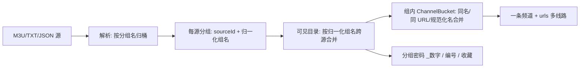

# OwnTV 频道分组归类方案（借鉴 nTv 频道目录）

> 范围：`OwnTV_Core`（分支 `mobile`，HEAD `c4d9d0cb`，含未提交的 TXT/TVBox 解析器与 `ChannelLines` 改动）；宿主为 `OwnTV_Mobile`（分支 `mobile-mini`，HEAD `6d0c2c65`，core 以 `vendor/OwnTV_Core` 子树参与构建）与 `OwnTV`（TV）。
> 基线日期：2026-11-08。
> 参考：`NativeWasmTv/docs/source-import-playback-and-apk-size.md`，以及其 `PlaylistManager.java`、`ChannelCatalog.java`、`GroupPassword.java` 的实际实现；`OwnTV_Mobile/mobile-mini` 的 LiveScreen、LiveViewModel、LiveTuner、LiveOverlayPanel、CustomizeViewModel。
> 本文只讨论**频道分组归类**；源下载/播放链路/APK 体积不在范围内。

---

## 0. 结论摘要

### 0.1 一句话结论

nTv 的分组能力不是"给频道加一个 group 字段"，而是三层：**解析时按分组名归桶 → 多源可见列表按分组名再合并 → 分组内同名频道折叠成一条多线路频道**，分组密码和编号都挂在这三层上。OwnTV 已经有等价的底层能力（`categories`、稳定键、`ChannelLines`、`PlaylistNumbering`、分类锁定），缺的是**分组名归一化、跨源合并投影、分组密码、以及列表/播放层的线路折叠**。建议在 `:core` 增加一个**只读的分组投影层**，不改 `categories`/`channels` 的持久化语义、不改频道稳定键，从而在不破坏收藏/历史/EPG/备份的前提下得到 nTv 的可见效果。

### 0.2 借鉴与不借鉴

| nTv 机制 | 是否借鉴 | 在 OwnTV 的落点 |
|---|---|---|
| `normalizeGroupTitle`：去 `在线·`/`在线-` 前缀、空分组归默认组 | **借鉴** | 新增 `ChannelGroups` 归一化函数，只在 merge 投影时使用 |
| 解析阶段按 `sourceId + 分组名` 归桶 | **已等价** | `categories` 的 `(sourceId, mediaType, remoteId)` 唯一键 + `M3uSyncer.queueCategory` |
| 可见目录按归一化分组名跨源合并 | **借鉴** | 新增 `LiveGroups` 投影；`LiveKey.Group` + 多分类查询 |
| `ChannelBucket` 按名称/URL/规范化频道名合并为多线路 | **部分借鉴** | 已有 `ChannelLines`；DB 仍保留一行一条线路，列表折叠，播放按线路回退 |
| 分组名 `_数字` 后缀作为分组密码 | **借鉴** | 从 M3U 分类的 `remoteId` 解析；会话内存解锁，复用 `CategoryUnlockSession` 语义 |
| CCTV 优先的频道编号 | **不借鉴（已有替代）** | `PlaylistNumbering` 已按播放列表顺序编号；合并视图编号另有取舍，见 §4.9 |
| SQLite 目录快照 + 指纹 + 启动占位组 | **不借鉴** | OwnTV 的 Room + 稳定键 upsert 已是单一事实源；再加一层快照会制造两份真相 |
| 手机端结构化合并导入 | **不借鉴** | OwnTV 本身就是逐源入库，源边界天然保留 |

### 0.3 实施轮廓

| 阶段 | 内容 | 是否改 schema | 风险 |
|---|---|---|---|
| V1 | 分组名解析/归一化、跨源合并投影、默认分组、`LiveKey.Group`、分组查询/计数/搜索 | 否 | 中 |
| V2 | 分组密码、锁定贯通、App 侧密码弹窗 | 否 | 中 |
| V3 | 列表线路折叠的跨页一致性（`lineKey`），**非 mobile-mini 必需** | 是（v54） | 高，可独立上线 |
| 不做 | 目录快照/指纹、启动占位、CCTV 专用编号 | — | — |

### 0.4 本版相比上一版的调整（结合 `mobile-mini`）

1. **线路折叠不再是待做项**：`mobile-mini` 的播放页左侧悬浮层已经用 `ChannelLines.group/linesOf` 折叠并实现了失败线路回退（[LiveTuner.kt:932](file:///e:/develop/ideaPoject/git/Own/OwnTV_Mobile/app/src/main/java/tv/own/owntv/mobile/ui/screens/live/LiveTuner.kt#L932)、[LiveTuner.kt:998](file:///e:/develop/ideaPoject/git/Own/OwnTV_Mobile/app/src/main/java/tv/own/owntv/mobile/ui/screens/live/LiveTuner.kt#L998)）。V3 的 `lineKey` 只为 Guide 分页/TV 端一致性保留，不作为本轮的验收项。
2. **隐藏合并组必须是"全列表隐藏"**：`mobile-mini` 对 provider 文件夹的隐藏本来就会把频道从 All/搜索/计数里剔除（[LiveViewModel.kt:210](file:///e:/develop/ideaPoject/git/Own/OwnTV_Mobile/app/src/main/java/tv/own/owntv/mobile/ui/screens/live/LiveViewModel.kt#L210)）。合并组沿用同一语义，而不是"只收起 rail 入口"。
3. **补上 mobile-mini 接入清单**：Live 页是纯分类页，分组是主界面；`LiveKey.Group` 会牵动约 30 处 `when`、Guide 分页、播放页悬浮层、Customize 页和分类锁 UI，文档给出逐文件落点。
4. **补上 core → vendor 的跨仓顺序**：core 改完先在 `OwnTV_Core/mobile` 提交，再 `git subtree pull` 到 `OwnTV_Mobile/vendor/OwnTV_Core`；`mobile-mini` 当前有未提交改动，必须先处理工作区。

---

## 1. nTv 的分组归类机制（读码结论）

### 1.1 三层结构



对应代码：

| 层 | 位置 | 行为 |
|---|---|---|
| 解析归桶 | `PlaylistManager.java:1585` `parse`、`:1700` `add` | `add` 先 `normalizeGroupTitle(groupName)` 再入 `ChannelBucket` |
| 每源合并 | `PlaylistManager.java:1413` `merge` | key = `playlistSourceId + "\u001f" + normalizeGroupTitle(title)`，同一源内同名组先合并 |
| 可见合并 | `PlaylistManager.java:814` `mergeVisible` | key = `normalizeGroupTitle(title).toLowerCase()`，跨源同名组合并；显示名取首次出现的组名 |
| 频道折叠 | `PlaylistManager.java:1752` `ChannelBucket.add` | 按 `name:`、`url:`（canonicalSourceUrl）、`channel:`（canonicalChannelName）三种键匹配；命中则保留首个 logo/字幕/radio/回看并追加 URL |
| 分组密码 | `GroupPassword.java:4` | 组名末尾 `_` + 全数字拆成 `title` + `password`；解锁状态只在内存 |
| 编号 | `PlaylistManager.java:1717` `channelNumber` | `tvg-id`/名称里的 CCTV 数字优先，否则按组内顺序 |

### 1.2 关键规则

1. **归一化只发生在"组名"上，不改频道稳定键**。`normalizeGroupTitle`（`:1557`）只做四件事：
   - 去 `Chrome书签 / ` 前缀；
   - 循环去 `在线` + `·`/`・`/`-`/`－`/`—`/`:`/`：` 前缀；
   - 空串 → `在线频道`；
   - 其余原样（大小写只在 `groupKey` 里转小写）。
2. **每源键与可见键是两套**。持久化/缓存按 `sourceId + 组名` 保留源边界；用户看到的列表才按组名跨源合并。这样重启后不会不知道某个同名组属于哪个源。
3. **折叠是多线路，不是多行**。同名频道的第二、第三条 URL 追加进 `Channel.urls[]`，logo/字幕/回看只保留第一个非空值；播放失败时沿 `urls` 走。
4. **密码组不参与普通合并**。`normalizeGroupTitle` 不剥 `_数字`，所以 `体育_111` 与 `体育_222` 在 `mergeVisible` 里是两个 key；显示名再由 `GroupPassword` 剥掉后缀。密码只在本次进程内有效。
5. **编号不是分组的一部分**。分组只决定"在哪个桶里"，编号是解析/建目录时另外算的。

### 1.3 哪些能迁移，哪些不能

- 能迁移的是**规则**：组名归一化、跨源同名合并、组内频道折叠、密码后缀、源边界保留。
- 不能迁移的是**存储形态**：nTv 的 `Channel` 每次从源重建，`urls[]` 可以直接持有全部线路；OwnTV 的频道行是收藏/历史/EPG/录制/进度的稳定键，**合并 URL 会重写稳定键**，代价远大于收益。因此 OwnTV 采用"行不变、视图折叠"。

---

## 2. OwnTV 现状

### 2.1 解析与源边界

- 三种 M3U 家族解析器都输出同一个 `M3uEntry`，分组信息只有一个 `groupTitle`：
  - [M3uParser.kt:118](file:///e:/develop/ideaPoject/git/Own/OwnTV_Core/core/src/main/java/tv/own/owntv/core/parser/M3uParser.kt#L118) `group-title` 属性；
  - [TxtPlaylistParser.kt:162](file:///e:/develop/ideaPoject/git/Own/OwnTV_Core/core/src/main/java/tv/own/owntv/core/parser/TxtPlaylistParser.kt#L162) `分组名,#genre#`；
  - [TvBoxPlaylistParser.kt:62](file:///e:/develop/ideaPoject/git/Own/OwnTV_Core/core/src/main/java/tv/own/owntv/core/parser/TvBoxPlaylistParser.kt#L62) 父对象的 `group`/`name` 继承。
- `M3uSyncer` 按组名建分类：`queueCategory`（[M3uSyncer.kt:136](file:///e:/develop/ideaPoject/git/Own/OwnTV_Core/core/src/main/java/tv/own/owntv/core/sync/M3uSyncer.kt#L136)）写入 `CategoryEntity(name = group, remoteId = group)`；频道行用 `categoryId` 指向该分类（[M3uSyncer.kt:203](file:///e:/develop/ideaPoject/git/Own/OwnTV_Core/core/src/main/java/tv/own/owntv/core/sync/M3uSyncer.kt#L203)）。
- Xtream/Stalker 分类走 `SyncSupport.refreshCategories`（[SyncSupport.kt:190](file:///e:/develop/ideaPoject/git/Own/OwnTV_Core/core/src/main/java/tv/own/owntv/core/sync/SyncSupport.kt#L190)），`remoteId` 是 provider 的分类 id，`name` 是 provider 组名。

### 2.2 分类模型与 rail

- `CategoryEntity`：`(sourceId, mediaType, remoteId)` 唯一，`name` 原样保存，`sortOrder` 是 provider 顺序（[ContentEntities.kt:32](file:///e:/develop/ideaPoject/git/Own/OwnTV_Core/core/src/main/java/tv/own/owntv/core/database/entity/ContentEntities.kt#L32)）。
- `CategoryDao.observe` 按 **源创建顺序 → 分类 sortOrder → 名称** 返回全部源的全部分类（[CategoryDao.kt:26](file:///e:/develop/ideaPoject/git/Own/OwnTV_Core/core/src/main/java/tv/own/owntv/core/database/dao/CategoryDao.kt#L26)）。因此多源时**同名分组会出现多次**。
- `CustomizeKeys.category` = `"<sourceId>:<remoteId ?: name>"`（[CustomizationStore.kt:29](file:///e:/develop/ideaPoject/git/Own/OwnTV_Core/core/src/main/java/tv/own/owntv/core/customize/CustomizationStore.kt#L29)）；隐藏/改名/排序/锁定全部挂在这个稳定键上。
- `railCategories` → `applyCustomizationsWithCustoms`：自定义分类在前，provider 分类按自然顺序，手动位置用 `placePinned` 固定（[CategoryOrdering.kt:19](file:///e:/develop/ideaPoject/git/Own/OwnTV_Core/core/src/main/java/tv/own/owntv/core/customize/CategoryOrdering.kt#L19)、[CustomizationStore.kt:398](file:///e:/develop/ideaPoject/git/Own/OwnTV_Core/core/src/main/java/tv/own/owntv/core/customize/CustomizationStore.kt#L398)）。

### 2.3 频道行与线路

- 频道行是"一条线路一行"：同一 `name + group` 的重复条目用 `name␁group␁#n` 稳定键保留（[M3uSyncer.kt:713](file:///e:/develop/ideaPoject/git/Own/OwnTV_Core/core/src/main/java/tv/own/owntv/core/sync/M3uSyncer.kt#L713)）。`remoteId` 不能改，否则收藏/历史/进度会孤儿化。
- `ChannelLines` 已提供按"provider 名称 + 国家"折叠的纯函数（[ChannelLines.kt:20](file:///e:/develop/ideaPoject/git/Own/OwnTV_Core/core/src/main/java/tv/own/owntv/core/live/ChannelLines.kt#L20)）；core 内由 `PlaylistNumbering` 使用（[PlaylistNumbering.kt:57](file:///e:/develop/ideaPoject/git/Own/OwnTV_Core/core/src/main/java/tv/own/owntv/core/sync/PlaylistNumbering.kt#L57)），`mobile-mini` 的播放悬浮层也已接入（见 §2.7.2）。
- `PlaylistNumbering` 已按"频道族"编号：同一 `ChannelLines.keyOf` 的六条线路只占一个号码（[PlaylistNumbering.kt:45](file:///e:/develop/ideaPoject/git/Own/OwnTV_Core/core/src/main/java/tv/own/owntv/core/sync/PlaylistNumbering.kt#L45)）。

### 2.4 自定义与锁定

- 隐藏/改名/手动排序/自定义合并分类：`SectionCustomizations` + `CustomizationStore`（[CustomizationStore.kt:119](file:///e:/develop/ideaPoject/git/Own/OwnTV_Core/core/src/main/java/tv/own/owntv/core/customize/CustomizationStore.kt#L119)）。
- 分类 PIN 锁定：`CategoryLockRules.withLocks`（[CategoryLockRules.kt:15](file:///e:/develop/ideaPoject/git/Own/OwnTV_Core/core/src/main/java/tv/own/owntv/core/customize/CategoryLockRules.kt#L15)）+ `CategoryLockView`（[CategoryLockView.kt:26](file:///e:/develop/ideaPoject/git/Own/OwnTV_Core/core/src/main/java/tv/own/owntv/core/customize/CategoryLockView.kt#L26)）+ `CategoryUnlockSession`（内存、按 profile/type 会话有效）。
- **没有分组密码**：nTv 的"组名自带密码"在 OwnTV 不存在；现有 PIN 锁需要 profile 已设置 Customize PIN。

### 2.5 编号

- `PlaylistNumbering` 已实现"无 `tvg-chno` 时按文件顺序 1..N、有则全用 provider 号码"（[PlaylistNumbering.kt:25](file:///e:/develop/ideaPoject/git/Own/OwnTV_Core/core/src/main/java/tv/own/owntv/core/sync/PlaylistNumbering.kt#L25)）。这是 nTv CCTV 优先编号的替代方案（并非逐字等价），本方案不重复建设；合并视图的号码取舍见 §4.9。

### 2.6 约束

1. **Room 是唯一事实源**。分类/频道行由同步 upsert 维护，不用第二份 catalog 快照。
2. **稳定键不可变**。`channels.remoteId`、`categories.remoteId`（M3U 场景）都是用户数据的挂载点。
3. **`:core` 无 UI**。只提供数据、纯函数和查询；rail 绘制、密码弹窗在两个 App 仓库。
4. **i18n 有门禁**。新增用户可见文案必须进三套 `values`，新增代码字面量要登记 `tools/i18n/safe_literals.txt`。
5. **两个宿主共用 core**。新增 sealed 变体/字段会编译到 App；必须提供迁移指南。

### 2.7 `mobile-mini` 宿主现状（本方案的主要落点）

#### 2.7.1 Live 页就是"分类页"

- 主页面只有分类列表，点分类即播放该分类第一个频道：`LiveScreen.kt:53-65` 的 KDoc 与 `:113-125` 的 `play(key)`。
- 分类模型 `LiveCategory`（`LiveViewModel.kt:85-96`）已经带 `locked`/`sealed`，分类列表由单一构建函数 `buildLiveCategories`（`:103-134`）生成，同时供 Live 页、Guide 的分类弹窗和播放页左侧悬浮层使用。
- 分类标签/国家标题/画质标签已经在用 core 的 `ProviderTags`：`LiveScreen.kt:137-147`、`LiveCategoriesSheet.kt:68-74`。合并组只要给出正确的显示名/国家/tags，就能直接沿用现有视觉。
- 因此**分组归类在 mobile-mini 不是"二级 rail"，而是主界面本身**：合并后 rail 少几行重复组，收益直接可见。

#### 2.7.2 线路折叠与回退已经落地

- 播放页悬浮层的频道列按 `ChannelLines.Group` 绘制，一行一个频道：`LiveOverlayPanel.kt:239-253`。
- `LiveTuner.channelsInCategoryForPicker` 返回 `List<ChannelLines.Group>`（`:932-963`）；`loadSiblings` 保存 `loadedLines`（`:1022`）；`failoverToNextLine`（`:1034-1043`）在一条线路失败时换下一条。
- `overlayCategories` 的分类计数也是按折叠后的 `Group.size` 算的（`:989`）。
- 结论：**不需要为 mobile-mini 新增 `channels.lineKey`**。V3 只解决 Guide 分页（`GuideScreen.kt:158` 仍是未折叠的 `PagingData`）和 TV 端一致性；可以独立评估。

#### 2.7.3 计数口径已经不一致（合并组会继承）

- Live 页分类计数：`LiveViewModel.categoryCounts` 对非 `Folder` 用 `liveCountFlow`，对 `Folder` 用 `observeCountsByCategory`（`:275-286`）——**按频道行数**。
- 播放页悬浮层计数：`overlayCategories` 用 `channelsInCategoryForPicker(...).size`（`:989`）——**按折叠后的频道族数**。
- 同一份播放列表列了 6 条线路时，两个数字本来就可能不同。合并组沿用各自口径即可，不在本轮强行统一；要统一就得引入 `lineKey`（V3）。

#### 2.7.4 `LiveKey` 被三类列表复用

`LiveKey` 不只是 Live 的键，还被 Guide、Movies/Series 的 `LibraryViewModel` 复用。新增 `LiveKey.Group` 会让这些 `when` 变成非穷举，必须逐处补分支；具体清单见 §6.4。**这是本方案在 mobile-mini 上最大的编译面**。

#### 2.7.5 分类编辑的现状

- Live 页长按分类只有"重命名/隐藏"（`LiveCategoriesSheet.kt:142-153`、`LiveScreen.kt:192-208`）。
- 隐藏 provider 文件夹是**全局**的：`hiddenCategoryIds` 会把隐藏分类解析成 DB id（`LiveViewModel.kt:210-213`），再被 `liveCountFlow`/`isChannelVisible` 用来把频道从 All、搜索、计数里剔除。合并组的隐藏必须沿用这个语义，否则会出现"rail 收起但 All 里还在"的矛盾。
- 隐藏后的恢复入口在 Settings → Customize（`CustomizeViewModel.rows`，`:139-193`）。**合并组若只写一个 `group:<key>`，Customize 的现有行构建器看不到它，用户将无法取消隐藏**；因此 Customize 页必须同步支持合并组，见 §6.4。

#### 2.7.6 设置页的落点

`SettingsBrowsingPage` 的"Live categories"段（`SettingsLayoutPages.kt:68-76`）已经有 Catch-up / All channels 两个开关，是"合并同名分组"开关最自然的位置；设置值走 `SettingsRepository` 与备份白名单。

---

## 3. 差距

| 差距 | 现状 | 用户可见影响 | 方案 |
|---|---|---|---|
| 分组名未归一化 | `在线·体育`、`体育` 是两个分类 | 同名组重复、空组散落在 All | 投影层归一化，显示名去前缀/标签 |
| 跨源未合并 | 每个源各自一组 | 两个播放列表装同一批台时，rail 里出现两套"体育/新闻" | `LiveGroups` 按 key 合并 |
| 空分组无入口 | `groupTitle == null` 的频道只在 All 里 | 无法只浏览"未分组" | 虚拟默认组 `Group("")` |
| 无分组密码 | 只能靠 profile PIN | 源里 `_1234` 后缀被当成组名显示，或用户无法只锁一个组 | 解析后缀 + 会话解锁 |
| 组内多线路未在列表层统一 | 行保留；core 的 `ChannelLines` 已折叠，mobile-mini 播放悬浮层已接入 | Live 分类页不显示频道；播放悬浮层已一行一频道，Guide 仍可能重复 | 合并组直接复用 `ChannelLines`；Guide/TV 的跨页一致性留给 V3 |
| 合并视图编号冲突 | 每源独立编号 | 两个源的 CCTV1 都显示 1 | V1 保留 provider 号码；mobile-mini 的播放悬浮层不显示播放源标记，重复号码暂不处理，统一编号另立需求 |

---

## 4. 总体设计

### 4.1 分层

```mermaid
flowchart LR
    A[categories 行: 每源原样] --> B[ChannelGroups: 解析组名/归一化/密码]
    B --> C[LiveGroups: 按 key 合并可见分类]
    C --> D[CustomizedCategory / LiveKey.Group]
    D --> E[livePagingSource: categoryId IN (...)]
    E --> F[App rail + 列表]
    F --> G[ChannelLines: 组内线路折叠]
    G --> H[播放: 当前线路 / 下一线路]
```

**关键原则：A 层不动。** 归一化、合并、密码都发生在 B/C/D 的只读投影里。同步、稳定键、备份、EPG 都不需要迁移。

### 4.2 分组身份

```kotlin
/** 一个 provider 分组在 OwnTV 里的身份。 */
data class ProviderGroup(
    val raw: String,          // 原始组名：M3U 分类的 remoteId，其余分类的 name
    val displayName: String,  // 去掉国家前缀/画质标签/密码后缀后的显示名；空组为 ""
    val key: String,          // 合并键；空组为 ""
    val country: String?,     // "DE"/"UK"…；无前缀为 null
    val tags: List<String>,   // provider 的画质/来源标签（ᴴᴰ / ᴿᴬᵂ…），供 StageTag 使用
    val password: String?,    // M3U 的 `_数字` 后缀；其余为 null
)
```

**key 组成**：

```text
key = normalizeKey(displayNameForMerge).lowercase(Locale.ROOT)
      + "\u0001"
      + (country ?: "")
```

- `\u0001` 与 `M3uSyncer.stableKey` 使用同一分隔符，避免与真实组名冲突。
- `country` 来自 `ProviderTags.parse`（[ProviderTags.kt:30](file:///e:/develop/ideaPoject/git/Own/OwnTV_Core/core/src/main/java/tv/own/owntv/core/live/ProviderTags.kt#L30)）的国家前缀，避免 `DE| Sport` 与 `US| Sport` 被合并成一组。
- 空组 key 固定为 `""`，不写库、不参与密码。
- 带密码组：**合并名**用 `ProviderTags.parse` 后的 `name`（保留 `_数字` 后缀），这样 `体育_111` 与 `体育_222` 不会合并；**显示名**另用去掉后缀的那份解析，所以 rail 上只看到 `体育`。

### 4.3 归一化规则

组名归一化只在 `MERGED` 投影里使用，且只对 `LIVE` 生效；Movies/Series 不动。密码解析独立于模式，`PER_PLAYLIST` 下也可用。

| 输入 | displayName | key（示意） | 说明 |
|---|---|---|---|
| `体育` | `体育` | `体育␁` | 普通组 |
| `  体育  ` | `体育` | `体育␁` | trim + 折叠空白 |
| `在线·体育` | `体育` | `体育␁` | 去 `在线` + 分隔符，循环 |
| `在线-体育` | `体育` | `体育␁` | 同上 |
| `在线：体育` | `体育` | `体育␁` | 全角/半角冒号 |
| `在线体育` | `在线体育` | `在线体育␁` | 没有分隔符，不剥 |
| `DE\| Sport` | `Sport`（heading 为 DE 时） | `sport␁DE` | 国家参与 key |
| `Sport ᴴᴰ` | `Sport` | `sport␁` | `ProviderTags` 剥上标画质标签 |
| `体育_1234` | `体育`（锁） | `体育_1234␁` | 密码组不与非密码组混并 |
| `体育_1234`（两个源） | `体育`（锁） | `体育_1234␁` | 同密码可跨源合并 |
| `` / `null` | 由 App 用 `R.string.live_group_ungrouped` | `` | 默认组，不写库 |
| `VIP` / `其他` | 原样 | `vip␁` / `其他␁` | 不做语义归类 |

实现建议：

```kotlin
object ChannelGroups {
    private val ONLINE_SEPARATORS = listOf("·", "・", "-", "－", "—", ":", "：")

    /** 循环去掉 "在线" + 分隔符；"在线体育" 没有分隔符，原样保留。 */
    fun stripOnlinePrefix(value: String): String {
        var text = value.trim()
        while (text.startsWith("在线")) {
            val rest = text.removePrefix("在线").trimStart()
            val sep = ONLINE_SEPARATORS.firstOrNull { rest.startsWith(it) } ?: break
            text = rest.removePrefix(sep).trim()
        }
        return text
    }

    fun of(raw: String?, sourceType: SourceType): ProviderGroup { ... }

    /** 仅用于 key；显示名保留 provider 的大小写。 */
    fun normalizeKey(name: String): String =
        Normalizer.normalize(name, Normalizer.Form.NFKC)
            .replace(Regex("\\s+"), " ")
            .trim()
            .lowercase(Locale.ROOT)
}
```

显示名再交给 `ProviderTags.groupLabel(parsed, headingCountry)`：同一 rail 的组共享国家时省略前缀，混合国家时把 `DE| ` 放回去（[ProviderTags.kt:64](file:///e:/develop/ideaPoject/git/Own/OwnTV_Core/core/src/main/java/tv/own/owntv/core/live/ProviderTags.kt#L64)）。

密码拆分对齐 nTv：

```kotlin
fun splitPassword(raw: String): Pair<String, String?> {
    val at = raw.lastIndexOf('_')
    if (at <= 0 || at == raw.lastIndex) return raw to null
    val suffix = raw.substring(at + 1)
    return if (suffix.all(Char::isDigit)) raw.substring(0, at) to suffix else raw to null
}
```

- **只对 `SourceType.M3U` 生效**：M3U/TXT/TVBox 的组名是用户文本；Xtream/Stalker 的 `remoteId` 是 provider 分类 id，`_数字` 更可能是真组名。
- `debug` 构建可加日志，生产不输出密码值。

`ProviderGroup.raw` 取值：

```kotlin
fun rawTitleOf(cat: CategoryEntity, type: SourceType): String =
    if (type == SourceType.M3U && !cat.remoteId.isNullOrBlank()) cat.remoteId else cat.name
```

理由：M3U 的 `remoteId` 就是原始组名（`M3uSyncer.queueCategory`），而 Xtream/Stalker 的 `remoteId` 是数字/字符串 id，不能当组名。

### 4.4 合并投影算法

输入：当前 profile 可见源的 `List<CategoryEntity>`、源类型表、`SectionCustomizations`、kids 标记、分组模式。

源集合由 `ActiveProfileSources.liveSourceIds`（已含 `defaultSourceId` 过滤与 `syncLive`）给出，投影不自行扩大范围（[ActiveSources.kt:25](file:///e:/develop/ideaPoject/git/Own/OwnTV_Core/core/src/main/java/tv/own/owntv/core/repository/ActiveSources.kt#L25)）。

```kotlin
fun List<CategoryEntity>.toLiveGroups(
    section: MediaType,                 // 只处理 LIVE
    sourceTypes: Map<Long, SourceType>,
    cust: SectionCustomizations,
    kids: Boolean,
    mode: LiveGroupingMode,
    hasUngrouped: Boolean,              // 由 observeUngroupedCount 驱动；true 时才追加默认组
): List<LiveGroup>
```

算法：

1. 按 `AdultCategoryClassifier` 与 `hiddenCategories` 过滤不可见**成员分类**（与 `railCategories` 一致）。
2. 对每个分类求 `ProviderGroup`。
3. `LinkedHashMap<String, MutableList<CategoryEntity>>` 按 `key` 累积；**首次出现**的分类决定组的自然位置与基础显示名。
4. 合并后，若 `cust.hiddenCategories` 含 `group:<key>`，整组从 rail 移除（这是"隐藏合并组"的键）。
5. 计算 `countryHeading`：所有组共享的国家（`ProviderTags.sharedCountry`），供 UI 显示 "GROUPS · DE"。
6. 自定义分类仍排在最前（现有 `applyCustomizationsWithCustoms` 语义）。
7. 用户改名优先：`cust.categoryNames["group:$key"]`。
8. 用户手动位置：`cust.categoryPositions["group:$key"]`，未固定的组跟随排序 chip。

```kotlin
data class LiveGroup(
    val key: String,
    val displayName: String,          // provider 归一化名，未套用户改名
    val country: String?,
    val tags: List<String>,           // 首次出现成员的 provider 标签
    val categories: List<CategoryEntity>,
    val password: String? = null,     // 组内唯一密码；多个不同密码时按 key 已拆分
    val defaultGroup: Boolean = false,
) {
    val memberIds: List<Long> get() = categories.map { it.id }
    val sourceIds: Set<Long> get() = categories.mapTo(linkedSetOf()) { it.sourceId }
    val customizeKey: String get() = CustomizeKeys.group(key)
}
```

默认组：`categories` 为空、`defaultGroup = true`，只承载 `categoryId IS NULL` 的频道；当可见源里存在未分组频道时追加到 rail 末尾（可被移动/隐藏）。

### 4.5 分组模式

```kotlin
enum class LiveGroupingMode { PER_PLAYLIST, MERGED }
```

- `PER_PLAYLIST`：完全沿用今天的 `CategoryEntity` + `LiveKey.Folder`，显示名与 rail 顺序都不变；分组密码仍可加锁，但不改显示名。
- `MERGED`：使用 `LiveKey.Group`，按归一化组名跨源合并，并追加默认组。
- 单源时两种模式只差默认组与归一化显示，因此切换成本低。

**默认值建议**：`mobile-mini` 首发默认 `MERGED`——它的 Live 页就是分类页，重复组是主界面的直接痛点；设置里保留 `PER_PLAYLIST` 切回。TV 端按自己的页面形态在接入时决定。见 §11 D1。

组级隐藏/锁/位置以 `group:<key>` 存储，只在 `MERGED` 模式下解释；切到 `PER_PLAYLIST` 时它们不影响成员文件夹，存储保留，切回 `MERGED` 后恢复。Customize 页的行列表随模式切换，因此组级状态只在 `MERGED` 的 Customize 里可见。

### 4.6 分组密码

**存储**：不新增字段。密码从 M3U 分类的 `remoteId` 现场解析，解锁状态只在内存。

**判定**：

```kotlin
val group = ChannelGroups.of(rawTitle, sourceType)
val expected = group.password   // null = 不锁
```

**会话**：

- 复用 `CategoryUnlockSession`（[CategoryUnlockSession.kt:18](file:///e:/develop/ideaPoject/git/Own/OwnTV_Core/core/src/main/java/tv/own/owntv/core/customize/CategoryUnlockSession.kt#L18)），但增加"解锁门"参数：

```kotlin
enum class UnlockGate { PIN, GROUP_PASSWORD }

fun unlock(profileId: Long, type: MediaType, key: String, gate: UnlockGate, since: Long = epoch()): Boolean
fun isUnlocked(profileId: Long, type: MediaType, key: String, gate: UnlockGate): Boolean
```

- 一个组同时被 profile PIN 锁和自带密码保护时，两道门都要通过。
- 解锁作用域：profile + mediaType + group key；进程退出/切 profile/`relockAll()` 即失效。
- 不持久化、不进备份。
- `unlocked()` 要按 gate 分别返回两个集合；`withLocks` 现有"没有 PIN 就清空锁"的早退必须改成"只清 PIN 门，密码门保留"；`CategoryLockView.hasLocks` 也要把密码组算进去。
- `CategoryLockView.visible` 增加 `passwordKeys: Flow<Set<String>>`（由分类观察/`LiveGroups` 派生），`hasPin` 只作用于 PIN 门。
- `CategoryLockView` 的 sealed key → 分类 id 解析增加 `groupMemberIds: (String) -> List<Long>`（由 `LiveGroups` 提供）；否则 `group:<key>` 无法映射到成员分类 id。

**封禁范围**：密码组与 PIN 锁一样按"sealed"处理：

- rail 保留条目并显示锁；
- All / 搜索 / 收藏 / 历史 / 自定义分类里，其频道一律不出现，直到解锁；
- 锁定组的成员分类 id 汇入 `sealedCategoryIds`，现有 `isChannelVisible`、`sealsItemIn`、`liveCountFlow`、`SearchReader`、`HomeFeed` 的排除逻辑即可复用。

**App 侧**：在 `:core` 的 `categorylock` 增加一个提示类型（如 `CategoryLockPrompt.GroupPassword(type, key, expected)`），由 App 画弹窗；错误时保持封禁。

> 安全说明：这里的密码来自播放列表本身，不是 OwnTV 生成的秘密；`remoteId` 里本来就存着后缀，所以不需要哈希。它的作用是"防止误入/儿童误点"，不是密码学保护。

### 4.7 与隐藏/改名/排序/锁定

| 操作 | 现有键 | 合并模式下的键 | 语义 |
|---|---|---|---|
| 隐藏 | `sourceId:remoteId` | `group:<key>` | **全局隐藏**：`group:<key>` 解析成成员分类 id，频道从 All/搜索/计数里剔除；与 provider 文件夹隐藏一致。**不**用于自定义分类（自定义分类的隐藏仍是 rail-only） |
| 取消隐藏 | 同上 | 同上 | Settings → Customize 必须列出合并组行，否则隐藏后无处恢复（见 §6.4） |
| 改名 | `sourceId:remoteId` | `group:<key>` | 合并组显示用户改名；成员分类的改名仍可在切回单源模式时生效 |
| 排序 | `sourceId:remoteId` | `group:<key>` | `placePinned` 已支持任意键，无需改算法 |
| PIN 锁定 | `sourceId:remoteId` | `group:<key>` | 锁定整组，成员分类 id 全部 seal |
| 密码锁定 | 不适用 | `group:<key>` | 由组名后缀派生，不需要用户操作 |

`hiddenCategoryIds` 的解析要同时接受两类 key：

1. `sourceId:remoteId` → 现有 `AdultCategoryClassifier.hiddenCategoryIds`；
2. `group:<key>` → `LiveGroups` 的 `memberIds`。

两部分取并集后传给 `liveCountFlow` / `isChannelVisible` / 搜索与首页的排除逻辑。`sealedCategoryIds` 同理（见 §4.6 与 §7.4）。

`CustomizeKeys` 增加：

```kotlin
const val GROUP_PREFIX = "group:"
fun group(key: String): String = GROUP_PREFIX + key
fun isGroup(key: String): Boolean = key.startsWith(GROUP_PREFIX)
```

> "隐藏"与"锁定"的差异要在产品文案里说清：provider 文件夹/合并组的隐藏会把频道从 All/搜索/计数里剔除（Favorites/History 仍保留，与现有 `hiddenCategoryApplies` 一致）；自定义分类的隐藏只收起 rail 入口；锁定/密码则在所有列表都封禁。

### 4.8 组内多线路

V1：**不改 DB 语义**，只把 `ChannelLines` 接进列表层：

- `ChannelLines.group(rows)` 已按 `matchName` 的 provider 名 + 国家折叠（[ChannelLines.kt:43](file:///e:/develop/ideaPoject/git/Own/OwnTV_Core/core/src/main/java/tv/own/owntv/core/live/ChannelLines.kt#L43)）。
- **`mobile-mini` 已经接好**：`LiveTuner.channelsInCategoryForPicker` 返回 `ChannelLines.Group`，`LiveOverlayPanel` 一条频道一行，`loadSiblings` + `failoverToNextLine` 管线路回退（见 §2.7.2）。合并组只需要把 `channelsInCategoryForPicker(Group)` 的查询范围从单分类换成成员分类，其余折叠/回退逻辑原样复用。
- 已知限制：分页边界可能把同一族拆到两页（Guide 的分页列表）；Live 页的播放悬浮层用快照折叠，不受分页影响。
- 结论：**mobile-mini 本轮不需要 V3 schema**；V3 仅在需要 Guide 分页也折叠、或 TV 端未实现等价折叠时再启动。

V3（可选）：**加 `channels.lineKey`**：

| 变更 | 内容 |
|---|---|
| schema v54 | `channels.lineKey TEXT`（可空，便于回填），索引 `(sourceId, lineKey)`、`(categoryId, lineKey)` |
| 写入 | `M3uSyncer`/Xtream/Stalker 入库前统一写 `ChannelLines.keyOf(matchName)`（单点实现） |
| 回填 | 一次性后台任务，按 id 分批更新 `lineKey IS NULL` 的行；完成后置标记，避免每次启动重算 |
| 查询 | 组内分页用 `GROUP BY lineKey` 取代表行；All 视图可保留 `(categoryId, lineKey)` 作用域，避免把不同分组的同名频道折成一条；`linesOf` 按 `lineKey` 取全部线路 |
| 计数 | 按 `lineKey` 去重计数，与折叠后的列表一致 |
| 播放 | `LiveTuneController.advance` 在梯子耗尽后询问 `Host.nextLine(channel, triedIds)`；每条线路只试一次，全部失败才 `abandon` |

> 不把多条 URL 塞进一个频道行的原因：`channels.remoteId` 是收藏/历史/进度/EPG/录制的挂载点；改成"一条频道多 URL"需要把用户数据从"行 id"迁移到"频道族 id"，收益与风险不成比例。

### 4.9 编号与直达

- V1 不改 `PlaylistNumbering`。合并组里不同源的同号频道仍会显示相同号码；建议 App 在副标题里显示播放源名，或提供一个"不显示号码"的展示开关。
- 直达（`ChannelDao.findByNumber`，[ChannelDao.kt:247](file:///e:/develop/ideaPoject/git/Own/OwnTV_Core/core/src/main/java/tv/own/owntv/core/database/dao/ChannelDao.kt#L247)）仍按 provider 号码跨源查找，多命中时按可见性挑选；与今天一致。
- 若后续要"合并视图统一编号"：不要写回 `channels.number`，而是在 `LiveGroups` 上派生 `number`，直达时通过 group key → member ids 解析。列为 D3。

### 4.10 与 EPG / 收藏 / 历史 / 自定义分类

- **EPG**：频道行不变，`epgChannelId` 不变；合并组只是把多行放到一个视图。折叠成一条时，主线路用第一行的 guide，线路切换后的 guide 差异列为 V3 细节。
- **收藏/历史/进度**：仍指向具体频道行；合并组不改变 id，故不受影响。
- **自定义分类**：仍是用户自己的容器，成员用 `custom_category_members` 行 id；与合并组互不干扰。
- **录制/提醒**：按频道行，不变。
- **搜索**：合并组内搜索用 `categoryId IN (...)`；全局搜索结果按成员分类 id 过一遍 `sealedCategoryIds`，密码组不会漏出。

---

## 5. 数据与状态

### 5.1 不新增表、不改 schema（V1/V2）

- `categories` / `channels` 结构不变；不新增 `groupKey` 列。
- 原因：分组键由 `name`/`remoteId` 现场计算，分类数量远小于频道数量，内存合并成本可忽略；不落库就没有"归一化算法升级后旧行 key 过期"的回填问题。
- 唯一需要落库的是 V3 的 `channels.lineKey`。

### 5.2 设置项

```kotlin
// SettingsRepository
enum class LiveGroupingMode { PER_PLAYLIST, MERGED }
val liveGrouping: Flow<LiveGroupingMode>   // 缺省值 MERGED（mobile-mini）
suspend fun setLiveGrouping(mode: LiveGroupingMode)

// Keys
val LIVE_GROUPING = stringPreferencesKey("live_grouping")
```

- 新键要加入 `SettingsRepository.BackupKeys.strings`（[SettingsRepository.kt:3120](file:///e:/develop/ideaPoject/git/Own/OwnTV_Core/core/src/main/java/tv/own/owntv/core/settings/SettingsRepository.kt#L3120)）与 `SettingsBackupCoverageTest`。
- `SettingsImportRules.string` 增加白名单：只接受 `LiveGroupingMode.entries` 里的值（[SettingsImportRules.kt:30](file:///e:/develop/ideaPoject/git/Own/OwnTV_Core/core/src/main/java/tv/own/owntv/core/settings/SettingsImportRules.kt#L30)）。

### 5.3 备份/恢复

- 分组派生自源数据，恢复源后重新同步即恢复分组；不需要备份分类行。
- 新增设置键随 settings 备份走。
- 密码解锁状态**不备份**（内存态）。
- 备份版本无需提升；旧备份缺 `live_grouping` 时按默认值处理。

### 5.4 升级兼容

| 项 | 处理 |
|---|---|
| 当前选中的 `FOLDER:<id>` | `liveRestoreKey` 增加回退：若该分类属于某个合并组，选中对应 `GROUP:<key>` |
| 成员分类的用户改名 | 合并组默认用 provider 名；可选迁移：单成员组继承该成员的 `categoryNames` |
| 成员分类的手动位置 | 合并键默认无位置，跟随自然顺序；不自动搬运，避免覆盖用户已排好的顺序 |
| 隐藏的成员分类 | 只从合并组里剔除该成员，不影响其他源的同名成员；`hideNewCategoriesDefault` 仍按成员生效，全部成员被隐藏时合并组才消失 |
| 隐藏整个合并组 | 写 `group:<key>`；列表层解析成成员分类 id，频道从 All/搜索/计数剔除；Settings → Customize 的合并组行负责恢复 |
| Guide 的 `FOLDER:<id>` 记忆 | `GuideViewModel._selected` 从 Folder 扩展到 Group；合并组成员全消失时回落到 `landingKey` |
| 密码组改名/换密码 | `remoteId` 变化 → 分类行重建 → 该组自定义状态丢失；与今天的"组改名"一致，文档标注为已知限制 |

---

## 6. 代码改动清单

### 6.1 `:core` 新增

| 文件 | 职责 |
|---|---|
| `live/ChannelGroups.kt` | 组名解析、归一化、国家/画质/密码拆分、`ProviderGroup` |
| `live/LiveGroups.kt` | `LiveGroup`、跨源合并投影、默认组、成员 id、sealed id 汇总 |
| `live/LiveGroupingMode.kt`（或并入 `LiveKey.kt`） | 分组模式枚举 |
| `test/.../live/ChannelGroupsTest.kt` | 归一化/密码/国家/空组用例 |
| `test/.../live/LiveGroupsTest.kt` | 合并、顺序、隐藏、kids、默认组用例 |

### 6.2 `:core` 修改

| 文件 | 改动 |
|---|---|
| `live/LiveKey.kt` | 增加 `data class Group(val key: String) : LiveKey`；`serialize`/`parseLiveKey` 增加 `GROUP:`（URL 编码） |
| `live/LiveQueries.kt` | `livePagingSource`/`liveCountFlow` 增加 Group 分支；两者都新增 `groupIds: (String) -> List<Long>`（或直接传 `memberCategoryIds`）参数 |
| `database/dao/ChannelDao.kt` | 新增按 `categoryId IN` 的分页/搜索/计数查询、`snapshotInCategories`（播放悬浮层/首频道用）、`snapshotUngrouped`（默认组）、未分组查询与计数 |
| `database/dao/MovieDao.kt` / `SeriesDao.kt` | 新增 `pagingNone`/`searchNone` 空结果查询，供 `VodQueries` 处理不应出现的 `LiveKey.Group` |
| `customize/CustomizationStore.kt` | `CustomizeKeys.GROUP_PREFIX`/`group()`；`CustomizedCategory` 增加 `groupKey`/`memberCategoryIds`/`groupCountry`/`groupTags`/`passwordLocked`/`groupPassword`/`defaultGroup`（带默认值） |
| `customize/CategoryOrdering.kt` | `CategoryRailEditor.customizationKey` 支持 `LiveKey.Group`；新增合并 rail 的构造入口 |
| `customize/CategoryLockRules.kt` | `withLocks` 增加 `passwordKeys`/`passwordSealedIds`；`seals` 支持 Group |
| `customize/CategoryLockView.kt` | 把 `group:<key>` 的 sealed 键解析为成员分类 id；密码组不依赖 profile PIN |
| `customize/CategoryUnlockSession.kt` | 增加 `UnlockGate`（PIN / GROUP_PASSWORD） |
| `categorylock/CategoryLockPrompt.kt` / `CategoryLockFlow.kt` | 新增分组密码提示与提交流程 |
| `content/VodQueries.kt` | `LiveKey.Group` 不适用于 Movies/Series：加空结果分支（或 `pagingNone`），避免 exhaustive when 编译失败 |
| `live/LiveBuiltIns.kt` | `liveLandingKey` 把 Group 视为可落地的分类 |
| `live/LiveCategoryMemory.kt` | 记忆恢复支持 Group；`FOLDER:id` → Group 的回退 |
| `home/HomeFeed.kt` | `hiddenState.liveCats` 并入"隐藏合并组成员 id + sealedCategoryIds" |
| `content/SearchReader.kt` | 同上，隐藏分类 id 与 sealed id 取并集 |
| `live/ChannelVersions.kt` | 可见性过滤并入 `sealedCategoryIds` |
| `sync/M3uSyncer.kt` | **不改**稳定键；如需显示归一化也不改 `remoteId`；V3 才写 `lineKey` |
| `settings/SettingsRepository.kt` | 新设置键、读取、写入、备份白名单 |
| `settings/SettingsImportRules.kt` | 新枚举值的导入校验 |
| `res/values*/strings*.xml`、`tools/i18n/safe_literals.txt` | 新增 `live_group_ungrouped`、`live_group_password_title`、`live_group_password_wrong`、`live_group_sources_count`（多播放列表提示）、`settings_live_grouping` 及其描述；三语言齐全；归一化/密码字面量登记 `safe_literals.txt` |

### 6.3 `:player-core`

| 文件 | 改动 |
|---|---|
| `LiveTuneController.kt` | 仅 V3：`advance` 梯子耗尽时尝试下一条线路；新增 `Host.nextLine(channel, triedIds)` |
| `LiveEngines.kt` | 仅 V3：如需要，`LiveRequest` 增加线路标识；否则不变 |

### 6.4 `OwnTV_Mobile` / `mobile-mini` 接入清单

> 路径相对 `OwnTV_Mobile/app/src/main/java/tv/own/owntv/mobile/`。行号以 `mobile-mini` HEAD `6d0c2c65` 为准。

#### 6.4.1 Live 数据与分类模型

| 文件 | 改动 |
|---|---|
| `ui/screens/live/LiveViewModel.kt` | `LiveCategory`（`:85-96`）增加 `customizeKey`、`memberCategoryIds`、`sourceIds`、`country`、`tags`、`password`、`ungrouped`；`buildLiveCategories`（`:103-134`）改为接收 `sourceTypes`/`LiveGroupingMode`/`hasUngrouped`/默认组文案，用 core 的 `liveRailCategories`，把 `e.groupKey` 映射成 `LiveKey.Group`、`e.memberCategoryIds` 带进模型；`categoriesFor`（`:240-249`）的 combine 增加分组模式设置；`hiddenCategoryIds`（`:210-213`）并入"隐藏合并组成员 id"；`categoryCounts`（`:275-286`）给 `liveCountFlow` 传 member ids；`channels` pager（`:439-479`）给 `livePagingSource` 传 `groupCategoryIds`；`categoryContextKey`（`:315-319`）支持 `Group -> group:<key>`；`categoryRestorePlan`（`:293-303`）与 `restoreCategory` 对 Group 返回空/不执行（V1 不提供组级恢复）；`firstChannelOf`（`:644-673`）增加 Group 分支（默认组走 `snapshotUngrouped`）；`folderGone`（`:565-566`）扩展为 Group 是否还有成员；`applyCustomizations`（`:488-500`）的 `movedFromOrigin` 判定支持 Group；`contextKeyOf`（`:802-808`）对 Group 返回 null（V1 无组内手动排序）；`moveList`（`:811-823`）对 Group 返回空；`categoryKeyOf`（`:605-609`）优先返回频道所在合并组。 |
| `ui/screens/live/LiveTuner.kt` | `liveCategoriesForPicker`（`:907-922`）的 `railCategories` 映射增加 Group；`channelsInCategoryForPicker`（`:932-963`）增加 Group 分支：默认组用 `snapshotUngrouped`、普通合并组用 `snapshotInCategories`，`hidden` 取"现有 hiddenCategoryIds ∪ 隐藏合并组成员 id"，再做 `isChannelVisible` + `ChannelLines.group`；`overlayCategories`（`:970-993`）用新的 `buildLiveCategories`，Group 的计数走同一折叠路径；`loadSiblings`（`:998-1024`）在频道属于合并组时按成员分类取线路，否则保持原逻辑。`failoverToNextLine` 与 `_siblings` 不需要改。 |
| `ui/player/LiveOverlayPanel.kt` | 打开时"当前频道所在分类"（`:151`）改为调用 VM 的 `categoryKeyOf`，以便定位到合并组；分类行图标（`:216`）在 `locked` 时用 `MobileIcons.Lock`（与 LiveScreen 一致，密码组也需要）；频道长按的 `originKey`（`:286`）仍用频道自己的 `categoryId -> LiveKey.Folder`，**不要**用 Group 作为 `movedFromOrigin` 的 origin。 |
| `ui/screens/live/LiveScreen.kt` | `groups`（`:136`）继续取 `builtIn == null`，但默认组（`ungrouped = true`）不挂长按菜单；`openCategory`（`:123-125`）的 `lock.guarded` 要能区分 PIN 与分组密码；`parsed`/`ProviderTags.groupLabel`（`:137-147`）改为优先读 `LiveCategory.country/tags`，避免对已归一化的标题二次解析；分类行的 `mark` 用 `sourceIds.singleOrNull()`（多源合并组不显示单一播放源标记）。 |
| `ui/screens/live/LiveCategoriesSheet.kt` | 与 LiveScreen 相同的标签/国家/tags/标记逻辑（`:68-74`、`:104-113`）；默认组不提供长按菜单；Guide 的分类弹窗因此自动获得合并组。 |
| `ui/screens/guide/GuideViewModel.kt` | 非穷举 `when` 补 Group；维护 `groupCategoryIds`（categories + sourceTypes），传给 `livePagingSource`；`init` 的"分类失效"检查（`:190-191`）从 `Folder` 扩展到 Group（合并组成员全部消失时回落到 landing）；`applyCustomizations`（`:457`）的 `movedFromOrigin` 判定支持 Group。 |
| `ui/screens/guide/GuideScreen.kt` | `vm.channels`（`:158`）的 `livePagingSource` 需要 Group 分支（§6.2）；`liveLandingKey`（`:155`）已由 core 支持 Group；分类 crumb（`:196`）用 `LiveCategory` 的显示名。 |

#### 6.4.2 分类编辑与设置页

| 文件 | 改动 |
|---|---|
| `ui/screens/settings/customize/CustomizeViewModel.kt` | `CustomizeCatRow`（`:38-46`）增加 `groupKey`/`memberCategoryIds`/`sourceIds`；`rows`（`:139-193`）在 `Live + MERGED` 时改用 core 的 `liveRailCategories` 生成合并组行（`categoryId = null`、`key = group:<key>`、`originalName = group.displayName`、`providerName = 单一源名或多源时的"N 个播放列表"`）；`setCategoryHidden`（`:332-336`）与 `renameCategory`（`:339-343`）直接使用 `row.key`，无需改签名；`moveSingle` 同样按 group key 固定位置。**不做这一步，合并组一旦隐藏就没有恢复入口。** |
| `ui/screens/settings/SettingsLayoutPages.kt` | "Live categories"段（`:68-76`）新增"合并同名分组"开关，值来自 `SettingsRepository.liveGrouping`，`vm.edit { setLiveGrouping(...) }`；说明文案走 core 的 settings 字符串。 |
| `ui/screens/settings/SettingsViewModel.kt` | 跟随 `SettingsRepository` 新增 setter（若走通用 `edit {}` 则只需编译期可见）。 |
| `ui/categorylock/CategoryLock.kt` | `lockMenuState`（`:79-83`）增加 Group 分支（如果该页提供 PIN 锁入口；当前 `LiveCategoryMenu` 只有重命名/隐藏，PIN 锁入口可后置）；`guarded` 增加"分组密码"路径，密码组显示锁并走密码弹窗。 |
| `ui/categorylock/CategoryLockPrompts.kt` | 增加 `CategoryLockPrompt.GroupPassword` 的标题/输入处理（复用 `PinEntrySheet`，`password = true`、数字键盘）；`promptTitle` 区分"输入 PIN"与"输入分组密码"。 |
| `ui/categorylock/CategoryLockViewModel.kt` | `submit` 之外增加 `submitGroupPassword`；`open/toggleLock` 透传 gate。 |
| `ui/player/PlayerScreen.kt` | `playerCategories`（`:1027`）来自 `LiveTuner.liveCategoriesForPicker`，映射 Group；`selectedIndex`（`:1041`）在频道属于合并组时选中该 Group；`channelsInCategoryForPicker`（`:1045`）已按 Group 返回。 |

#### 6.4.3 VOD 侧的编译保护

`LiveKey` 被 Movies/Series 复用，以下 `when` 需要补 `is LiveKey.Group -> ...`（VOD 永远不会产生 Group，返回 `null`/空列表/`LiveKey.All` 均可）：

| 文件 | 位置 |
|---|---|
| `ui/screens/library/LibraryViewModel.kt` | `:309-310`、`:547`、`:568-569`、`:624`、`:814-818`、`:830-839` |
| `ui/screens/library/MoviePage.kt` / `SeriesPage.kt` | 只有 `LiveKey.All` 常量，无需改 |
| `ui/screens/library/VodActions.kt` | `:291` 只查 Folder，无需改 |

#### 6.4.4 不做的部分

- **不做** `channels.lineKey`、`ChannelDao` 的 `GROUP BY lineKey` 分页：`mobile-mini` 的播放悬浮层已经用 `ChannelLines` 折叠并做线路回退，Guide 的未折叠列表是既有行为，本轮不改。
- **不做** TV 端（`OwnTV`）的同批改动；它可以在 core 发布后按同一清单接入，避免两个 App 同时改 `LiveKey` 造成两套语义。
- **不做** "合并组内频道手动排序"：V1 的 `contextKeyOf(Group) = null`，组内顺序跟随播放源/A–Z；需要时再给 Group 建 `content_order` 上下文。

### 6.5 core → `vendor/OwnTV_Core` 同步

`mobile-mini` 通过 `vendor/OwnTV_Core` 子树参与 composite build（`docs/core-changes.md:28-33`），本仓库与 vendor 必须逐字节一致。落地顺序：

1. 在 `OwnTV_Core/mobile` 完成 core 改动并提交。
2. 在 `OwnTV_Mobile` 先处理当前 3 个未推送提交与工作区改动（`git status` 必须干净，`vendor/OwnTV_Core` 不能带着本地改动做 subtree pull）。
3. 执行：

```bash
git subtree pull --prefix vendor/OwnTV_Core <core-remote> mobile --squash
```

4. 校验 `vendor/OwnTV_Core` 与 `OwnTV_Core` 的 `core/`、`player-core/` 目录 `diff -rq` 为空（允许 vendor 中不参与构建的文档差异）。
5. 再提交 `mobile-mini` 的 App 侧改动；core 与 App 的接口变更放在同一个 PR/MR 里评审。

> 本轮 `mobile-mini` 已经带着大量未提交的 Live/Player/设置页改动；如果先做 subtree pull 再改 App，冲突面会更大。建议反过来：先提交 App 的"准备性"改动（如 `LiveKey.Group` 的空分支），再同步 core，最后补全逻辑。

---

### 6.6 本节结论

- `mobile-mini` 的 Live 页是分类页，合并组直接改变主界面；这是本方案最值得先做的宿主。
- 它已经解决了线路折叠/回退，**不要**为了"凑齐 nTv 的三层"再引入 `lineKey`。
- 真正的工作量在 `LiveViewModel`/`LiveTuner`/`CustomizeViewModel` 的 Group 分支和 `LiveKey` 的编译面，而不是 core 的解析逻辑。

---

## 7. 关键接口草图

### 7.1 `LiveKey.Group`

```kotlin
sealed interface LiveKey {
    data object Favorites : LiveKey
    data object History : LiveKey
    data object Catchup : LiveKey
    data object All : LiveKey
    data class Folder(val id: Long) : LiveKey
    data class Custom(val id: String) : LiveKey
    /** 合并后的 provider 分组；key 为空表示"未分组"。 */
    data class Group(val key: String) : LiveKey
}

fun LiveKey.serialize(): String = when (this) {
    // ...
    is LiveKey.Group -> "GROUP:" + URLEncoder.encode(key, "UTF-8")
}

fun parseLiveKey(s: String): LiveKey? = when {
    // ...
    s.startsWith("GROUP:") -> LiveKey.Group(URLDecoder.decode(s.removePrefix("GROUP:"), "UTF-8"))
    else -> null
}
```

`GROUP:` 用 URL 编码是必要的：组名可能包含 `:`、`|`、空格、中文；DataStore 里存的是普通字符串，编码后不会与 `FOLDER:`/`CUSTOM:` 混淆。

### 7.2 查询

```kotlin
// ChannelDao
@Query(
    "SELECT * FROM channels WHERE sourceId IN (:sourceIds) AND categoryId IN (:categoryIds) " +
    "ORDER BY name ASC"
)
fun pagingGroupAlpha(sourceIds: List<Long>, categoryIds: List<Long>): PagingSource<Int, ChannelEntity>

@Query(
    "SELECT * FROM channels WHERE sourceId IN (:sourceIds) AND categoryId IN (:categoryIds) " +
    "ORDER BY sourceId ASC, sortOrder ASC, name ASC"
)
fun pagingGroupOriginal(sourceIds: List<Long>, categoryIds: List<Long>): PagingSource<Int, ChannelEntity>

@Query("SELECT * FROM channels WHERE sourceId IN (:sourceIds) AND categoryId IS NULL ORDER BY name ASC")
fun pagingUngrouped(sourceIds: List<Long>): PagingSource<Int, ChannelEntity>

@Query("SELECT COUNT(*) FROM channels WHERE sourceId IN (:sourceIds) AND categoryId IS NULL")
fun observeUngroupedCount(sourceIds: List<Long>): Flow<Int>

@Query(
    "SELECT * FROM channels WHERE sourceId IN (:sourceIds) AND categoryId IN (:categoryIds) " +
    "AND name LIKE '%' || :query || '%' ORDER BY name ASC"
)
fun searchGroup(query: String, sourceIds: List<Long>, categoryIds: List<Long>): PagingSource<Int, ChannelEntity>
```

索引已存在：`(categoryId, name)`、`(categoryId, sortOrder, name)`、`(sourceId, sortOrder, name)`（[ContentEntities.kt:49](file:///e:/develop/ideaPoject/git/Own/OwnTV_Core/core/src/main/java/tv/own/owntv/core/database/entity/ContentEntities.kt#L49)），无需新增索引。

```kotlin
// LiveQueries.livePagingSource 追加参数
fun livePagingSource(
    key: LiveKey,
    // ...
    groupCategoryIds: (String) -> List<Long> = { emptyList() },
): PagingSource<Int, ChannelEntity> = when (key) {
    // ...
    is LiveKey.Group -> {
        val members = groupCategoryIds(key.key)
        if (key.key.isEmpty()) channelDao.pagingUngrouped(ids)
        else if (playlist) channelDao.pagingGroupOriginal(ids, members)
        else channelDao.pagingGroupAlpha(ids, members)
    }
}
```

计数：

```kotlin
is LiveKey.Group -> if (key.key.isEmpty()) {
    channelDao.observeUngroupedCount(ids)
} else {
    channelDao.observeCountsByCategory(ids).map { counts ->
        counts.filter { it.categoryId in members && it.categoryId !in sealedCats }
            .sumOf { it.itemCount }
    }
}
```

### 7.3 投影入口

```kotlin
/** rail + Customize 页共用：返回的顺序就是屏幕上的顺序。 */
fun liveRailCategories(
    categories: List<CategoryEntity>,
    cust: SectionCustomizations,
    customs: List<CustomCategory>,
    sourceTypes: Map<Long, SourceType>,
    kids: Boolean,
    alphabetical: Boolean,
    mode: LiveGroupingMode,
    hasUngrouped: Boolean,
    defaultGroupLabel: String,   // App 传入 R.string.live_group_ungrouped
): List<CustomizedCategory>
```

`LiveGroupingMode.PER_PLAYLIST` 时直接走现有 `applyCustomizationsWithCustoms`；`MERGED` 时把 `toLiveGroups` 的结果放进同一条排序管线（自定义分类在前、`placePinned` 固定位置）。

### 7.4 sealed / hidden id 汇总

```kotlin
/** 把 group:<key> 的锁解析成成员分类 id；PIN 锁的 sourceId:remoteId 仍走旧逻辑。 */
fun List<LiveGroup>.sealedCategoryIds(cust: SectionCustomizations): Set<Long> =
    flatMap { group ->
        if (group.customizeKey in cust.sealedCategories) group.memberIds else emptyList()
    }.toSet()

/** 隐藏合并组同样解析成成员分类 id；与 sealed 取并集后传给所有列表/计数。 */
fun List<LiveGroup>.hiddenCategoryIds(cust: SectionCustomizations): Set<Long> =
    flatMap { group ->
        if (group.customizeKey in cust.hiddenCategories) group.memberIds else emptyList()
    }.toSet()
```

`CategoryLockView.withSealedIds`、`HomeFeed`/`SearchReader` 的隐藏分类 id、`LiveViewModel.hiddenCategoryIds` 都取"旧集合 ∪ 新集合"。

### 7.5 `mobile-mini` 的 `LiveCategory` 扩展

```kotlin
data class LiveCategory(
    val key: LiveKey,
    val title: String? = null,
    val builtIn: BuiltIn? = null,
    /** 合并组可能来自多个播放列表；单源时用于分类行的 PlaylistMark。 */
    val sourceIds: Set<Long> = emptySet(),
    /** 合并组的成员分类 id；Folder/Custom 为空。 */
    val memberCategoryIds: List<Long> = emptyList(),
    /** 改名/隐藏/排序的稳定键：Folder/Custom 沿用现有键，Group 为 group:<key>。 */
    val customizeKey: String? = null,
    val country: String? = null,
    val tags: List<String> = emptyList(),
    val locked: Boolean = false,
    val sealed: Boolean = false,
    /** 组名 `_数字` 后缀；非密码组为 null。 */
    val password: String? = null,
    /** 未分组虚拟组：不提供长按菜单。 */
    val ungrouped: Boolean = false,
) { enum class BuiltIn { ALL, FAVORITES, HISTORY, CATCHUP } }
```

`buildLiveCategories` 的入参增加：

```kotlin
internal fun buildLiveCategories(
    cats: List<CategoryEntity>,
    cust: SectionCustomizations,
    alphabetical: Boolean,
    builtIns: LiveBuiltIns,
    catchupCount: Int,
    profile: ProfileEntity?,
    sourceTypes: Map<Long, SourceType>,
    mode: LiveGroupingMode,
    hasUngrouped: Boolean,
    defaultGroupLabel: String,
): List<LiveCategory>
```

- `MERGED`：用 core 的 `liveRailCategories`，`e.groupKey != null` 时生成 `LiveKey.Group`；
- `PER_PLAYLIST`：走原来的 `railCategories` 映射；
- 默认组：`LiveKey.Group("")`，`ungrouped = true`，排在自定义分类之后、provider 组末尾。
- `PER_PLAYLIST` 下 Folder/Custom 的 `country`/`tags` 可为空，UI 回退到现有的 `ProviderTags.parse(title)`；`MERGED` 的 Group 直接使用 core 给的字段。
- `locked = e.locked || e.passwordLocked`；`sealed = e.sealed`（密码组未解锁时为 true）。

---

## 8. 分阶段实施

### V1：分组投影（不改 schema）

1. 新增 `ChannelGroups` + 单测；先不接入任何调用方。
2. 新增 `LiveGroups` + 单测；覆盖跨源/国家/密码/空组/隐藏/kids。
3. 扩展 `LiveKey`、`CustomizeKeys`、`CustomizedCategory`；core 的 `ChannelDao` 增加分组查询/`snapshotInCategories`/未分组计数。
4. 扩展 `livePagingSource`、`liveCountFlow`、`liveRailCategories`；`LiveBuiltIns`/`LiveCategoryMemory` 支持 Group。
5. `mobile-mini` 的 V1 接入（§6.4）：
   - `LiveViewModel`/`LiveTuner` 的分类构建、首频道、Group 分支、成员计数；
   - `LiveScreen`/`LiveCategoriesSheet` 的默认组与标签字段；
   - `GuideViewModel`/`GuideScreen` 的 Group 分页与失效检查；
   - `CustomizeViewModel` 的合并组行（隐藏/恢复）；
   - `SettingsLayoutPages` 的合并开关；
   - `LibraryViewModel` 的编译保护空分支。
6. 新增 `liveGrouping` 设置，`mobile-mini` 首发默认 `MERGED`（§11 D1），开关可切回 `PER_PLAYLIST`。
7. i18n + 备份白名单 + 文档 + `vendor/OwnTV_Core` 同步（§6.5）。

**验收**：

- 单测覆盖所有归一化/合并用例；
- `mobile-mini` 双源同名组在 `MERGED` 下只出现一次，计数为成员分类之和；
- 点合并组能起播其第一个频道；播放悬浮层按成员分类折叠线路；
- 隐藏合并组后 All/搜索/计数都看不到成员频道，且 Customize 里能取消隐藏；
- `PER_PLAYLIST` 下 Live 页与今天逐字节一致；
- 现有收藏/历史/EPG 不受影响（无 schema、无稳定键变化）。

### V2：分组密码

1. `ChannelGroups` 增加密码拆分（仅 M3U 源）。
2. `CategoryUnlockSession` 增加 `UnlockGate`。
3. `withLocks`/`CategoryLockView` 把密码组纳入 sealed，不依赖 profile PIN。
4. `CategoryLockFlow`/`CategoryLockPrompt` 增加分组密码提示；`mobile-mini` 的 `CategoryLockPrompts` 用 `PinEntrySheet` 画数字密码输入，`LiveCategory.password` 传 expected。
5. 单测：后缀解析、错密码、会话失效、与 PIN 双门；真机验证 `LiveScreen` 点密码组→弹窗→起播。

**验收**：

- `分组名_1234` 显示为 `分组名` + 锁；
- 未解锁时 All/搜索/收藏都看不到该组频道；
- 输入 1234 后本次会话可见；重启后重新上锁；
- `_abcd`/`_` 结尾不误判。

### V3：线路折叠的跨页一致性（可选，独立上线，**mobile-mini 不需要**）

`mobile-mini` 的播放悬浮层已经完成折叠与线路回退；V3 只在以下情况启动：

- Guide 的分页频道列表也要"一条频道一行"（现在 `GuideScreen.kt:158` 是未折叠的 `PagingData`）；
- TV 端没有等价的 `ChannelLines` 接入；
- 需要统一 Live 页分类计数与播放悬浮层计数（前者按行、后者按族）。

实施内容：

1. schema v54：`channels.lineKey` + 索引 + 迁移。
2. 同步写入 `lineKey`；一次性回填任务。
3. 列表改用 `lineKey` 分组分页；计数按 `lineKey`。
4. `LiveTuneController` 增加 `Host.nextLine`（仅 TV/其他未实现回退的宿主；mobile-mini 已有 `failoverToNextLine`）。
5. 线路切换后的 EPG/字幕/回看继承规则单独评审。

**验收**：

- 同一频道 6 条线路在 Guide/分页列表只占 1 行；
- 收藏/历史/进度在合并视图下仍可回链到具体行；
- 170k 行目录的分页/计数无全表扫描。

---

## 9. 风险与对策

| 风险 | 影响 | 对策 |
|---|---|---|
| 跨源合并把不同语言/地区的同名组混在一起 | 用户看到不相关频道 | key 带国家前缀；无国家前缀的同名组合并是 nTv 的原语义，靠开关/单源模式兜底 |
| 合并组内频道名重复但不同台 | 列表折叠成一条 | V1 只折叠 `ChannelLines` 已判定的"同 provider 名 + 同国家"；V3 再收紧匹配 |
| 用户隐藏成员分类后组内只剩部分频道 | 预期差 | 在 UI 提示"该组由 N 个播放列表的分组合并"；提供切回单源模式的入口 |
| 合并组手动排序/改名状态与旧键不一致 | 升级后排序变化 | 默认不自动迁移；提供"恢复默认分组顺序"；`PER_PLAYLIST` 可随时切回 |
| `LiveKey.Group` 破坏 App 的穷举 `when` | `mobile-mini` 约 30 处编译失败 | 有意为之；按 §6.4 清单逐处补分支，VOD 侧返回空；core/App 同 PR 评审 |
| 合并组隐藏后无法恢复 | 用户找不到取消入口 | **必须**同步改 `CustomizeViewModel.rows`，把合并组行列入 Customize；否则不要提供组级隐藏 |
| Guide 选中合并组却无频道 | Guide 的 `livePagingSource` 未支持 Group | 同一批改动里补 Group 分页；未补前 Guide 可暂不展示合并组（只在 Live 页展示） |
| `vendor/OwnTV_Core` 与 core 不一致 | `mobile-mini` 编译到旧 core，接口对不上 | 按 §6.5 顺序同步；subtree pull 前工作区必须干净 |
| 密码组换后缀导致分类重键 | 该组隐藏/锁定状态丢失 | 与现有"组改名"一致，文档标注；后续可用 key 去后缀的映射表（D4） |
| `categoryId IN` 变量数上限 | 超大组查询失败 | 分组分类数正常 <100；加 `MAX_GROUP_CATEGORIES` 保护与日志，超限退化为单源模式 |
| 列表折叠与分页边界 | 同族跨页 | mobile-mini 的 Live 悬浮层用快照折叠，不受影响；Guide 分页保留现状，V3 再解决 |
| 搜索/首页漏掉 sealed 成员 | 密码组频道从侧门露出 | sealed/隐藏 id 并集清单：`CategoryLockView`、`HomeFeed`、`SearchReader`、`ChannelVersions`、`TvHomeRepository`、`LiveViewModel.hiddenCategoryIds` |
| 播放悬浮层计数代价 | 每个分类最多读 2,000 行，合并组读多个成员分类 | 沿用 `SIBLING_LIMIT`；必要时按 group 缓存，不在本轮改 |
| i18n 门禁 | CI 失败 | 新文案三语言齐全；归一化/密码字面量登记 `safe_literals.txt` |

---

## 10. 测试与验证

### 10.1 单元测试（纯函数）

| 用例 | 覆盖 |
|---|---|
| `ChannelGroupsTest` | `在线·`/`在线-`/`在线：`、全角空格、大小写、空组、`DE\|`、`UK:`、上标画质、`_1234`、`_abcd`、`_`、`体育_111` vs `体育_222` |
| `LiveGroupsTest` | 双源同名合并、国家不同不合并、首次出现定序、隐藏成员剔除、隐藏组→成员 id、kids 过滤、默认组、密码组不混并 |
| `CategoryLockRulesTest` | PIN 门、密码门、双门、无 PIN 时密码仍生效 |
| `CategoryUnlockSessionTest` | gate 隔离：PIN 解锁不等于密码解锁 |
| `LiveKeyTest` | `GROUP:` 序列化/反序列化、空 key、中文/`:`/`|` |
| `LiveBuiltInsTest` | `liveLandingKey` 把 Group 视为可落地 |
| `LiveCategoryMemoryTest` | `FOLDER:id` → `GROUP:key` 回退 |

### 10.2 DAO / 迁移

- 新增 `ChannelGroupDaoTest`（androidTest）：多分类 `IN` 分页、未分组分页、计数、删除成员分类后的行为。
- V3：`Migration53To54Test` + 回填任务测试。
- 参考现有 `OwnTVDatabaseMigrationTest.kt`、`ExcludingCountDaoTest.kt`。

### 10.3 真机矩阵

| 场景 | 期望 |
|---|---|
| 单 M3U 源 + `#genre#` TXT | 分组与今天一致；`在线·` 前缀被去掉 |
| 两个源同名组 | MERGED 只出现一次；PER_PLAYLIST 两套 |
| 未分组频道 | 默认组出现且只含 `categoryId IS NULL` 的频道；默认组无长按菜单 |
| 点合并组 | `LiveScreen` 起播成员分类的第一个可见频道；空组回退 All |
| 播放悬浮层 | 合并组的频道列按成员分类折叠，第一条线路失败自动换下一条 |
| 组名 `_1234` | 显示无后缀 + 锁；错/对密码行为正确；重启复锁 |
| 组名 `_2024`（Xtream 源） | 不当作密码 |
| 隐藏合并组 | All/搜索/计数都看不到；Settings → Customize 能取消隐藏并恢复 |
| Guide 选中合并组 | 分页列表按成员分类返回频道；成员全消失时回落到 landing |
| 收藏/历史/继续观看 | 合并前后都能回放、定位不变 |
| EPG | 频道 guide 不变；合并组不影响匹配 |
| 儿童 profile | 成人分类仍然被过滤，合并组只含非成人成员 |
| 170k 频道目录 | 打开 Live 分类页/切组无可感知卡顿；播放悬浮层计数不闪退 |

### 10.4 门禁

```bash
./gradlew :core:testDebugUnitTest
./gradlew :core:verifyI18nLiterals
# mobile-mini 的编译面（core 同步进 vendor 之后）
./gradlew :app:compileStandardDebugKotlin

python3 tools/i18n/test_i18n_tools.py
python3 tools/i18n/validate_strings.py --report text
python3 tools/i18n/gen_supported_locales.py check
python3 tools/i18n/check_hardcoded_strings.py verify --bootstrap
python3 tools/i18n/check_number_locale.py
python3 tools/i18n/check_text_overflow.py
```

> 当前工作区已有他人 WIP（ChannelFacets 字面量、sports/weather 删除）会让全局 literal 校验失败；本次改动的文件应单独确认 0 unclassified / 0 stale，不替他人清账。

### 10.5 性能基线

- 合并投影只看分类（数百到数千行），不做频道扫描。
- 分组分页走现有复合索引；首屏查询计划用 `EXPLAIN QUERY PLAN` 确认走 `(categoryId, sortOrder, name)` 或 `(categoryId, name)`。
- 计数用现有 `observeCountsByCategory`，不新增全表 COUNT。
- `mobile-mini` 的播放悬浮层用 `snapshotInCategories` + `SIBLING_LIMIT = 2_000`；合并组只增加成员分类数，不增加单分类行数上限。
- `LiveViewModel.categoryCounts` 对 Group 仍走 `observeCountsByCategory` 求和，不触发频道读取。
- V3 回填任务限制批大小（如 500 行），带取消检查，避免启动卡顿。

---

## 11. 待决策

| # | 决策 | 选项 | 建议 |
|---|---|---|---|
| D1 | V1 默认分组模式 | `PER_PLAYLIST` / `MERGED` | **`mobile-mini` 默认 `MERGED`**：Live 页就是分类页，重复组是主界面的直接痛点；设置里可切回单源。TV 端可在其接入时再决定 |
| D2 | 合并键是否带国家前缀 | 带 / 不带 | **带**；与 `ChannelLines`/`ChannelVersions` 的既有判断保持一致 |
| D3 | 合并视图是否统一编号 | 保留 provider 号码 / 派生统一编号 | **保留**；统一编号另立需求，不写回 `channels.number` |
| D4 | 密码组换后缀是否保留自定义状态 | 接受丢失 / 建映射表 | **接受丢失**（与组改名一致）；有强需求再做映射 |
| D5 | 隐藏合并组是否连带隐藏频道 | rail-only / 全列表 | **全列表**（与 `mobile-mini` 现有 provider 文件夹隐藏语义一致）；Customize 必须列出合并组以便恢复 |
| D6 | V3 是否进入本轮 | 是 / 否 | **否**：mobile-mini 已有折叠/回退；V3 只服务 Guide/TV，独立评审 |
| D7 | 合并组是否支持组内频道手动排序 | 支持 / 不支持 | **不支持**（V1 `contextKeyOf(Group)=null`）；需要时再建 `content_order` 上下文 |

---

## 12. 附录

### 12.1 用户可见行为前后对比

**今天（两个 M3U 源）**

```text
Live TV
├─ 在线·体育        (源 A)
├─ 新闻              (源 A)
├─ 体育              (源 B)
├─ News              (源 B)
└─ 所有频道
```

**MERGED 之后**

```text
Live TV
├─ 体育              (源 A 的 "在线·体育" + 源 B 的 "体育" 合并)
├─ 新闻              (源 A；与源 B 的 "News" 不同名，不合并)
├─ News              (源 B)
├─ 未分组            (两个源 categoryId IS NULL 的频道)
└─ 所有频道
```

> 合并只按归一化后的组名；`新闻` 与 `News` 是不同 key，不会因为"语义相同"被合并。需要跨语言归并时，应在源侧统一组名，而不是在客户端猜。

### 12.2 归一化伪代码

```text
fun identity(raw, sourceType):
    if raw is null/blank: return ProviderGroup("", "", "", null, emptyList(), null)

    rawTitle = raw
    password = null
    title = raw
    if sourceType == M3U:
        (title, password) = splitPassword(raw)      // 末尾 "_" + 全数字

    title = stripOnlinePrefix(title)                 // "在线·体育" -> "体育"
    displayParsed = ProviderTags.parse(title)        // 去国家前缀、上标标签
    display = displayParsed.name.trim()
    country = displayParsed.country
    tags = displayParsed.tags

    // 密码组：合并名保留 "_数字" 后缀，避免与无密码同名组混并；
    // 显示名仍用去掉后缀的那份解析。
    mergeParsed = if (password != null) ProviderTags.parse(stripOnlinePrefix(rawTitle)) else displayParsed
    mergeName = mergeParsed.name
    key = normalizeKey(mergeName) + "\u0001" + (country ?: "")

    return ProviderGroup(raw, display, key, country, tags, password)
```

### 12.3 文件索引

| 文件 | 作用 |
|---|---|
| `core/.../parser/M3uParser.kt` | `group-title` 解析 |
| `core/.../parser/TxtPlaylistParser.kt` | `#genre#` 分组 |
| `core/.../parser/TvBoxPlaylistParser.kt` | TVBox 嵌套分组 |
| `core/.../sync/M3uSyncer.kt` | 分类落库、稳定键、TVBox 外部源 |
| `core/.../sync/SyncSupport.kt` | Xtream/Stalker 分类刷新 |
| `core/.../database/entity/ContentEntities.kt` | `CategoryEntity`/`ChannelEntity`/索引 |
| `core/.../database/dao/CategoryDao.kt` | rail 分类读取 |
| `core/.../database/dao/ChannelDao.kt` | 分页/计数/搜索 |
| `core/.../customize/CustomizationStore.kt` | 稳定键、自定义分类、rail 定制 |
| `core/.../customize/CategoryOrdering.kt` | rail 顺序/移动 |
| `core/.../customize/CategoryLockRules.kt` | PIN 锁 fold |
| `core/.../customize/CategoryLockView.kt` | 锁到 DB id |
| `core/.../live/LiveKey.kt` | rail 选择键与序列化 |
| `core/.../live/LiveQueries.kt` | 选择键 → 查询 |
| `core/.../live/ChannelLines.kt` | 频道族折叠 |
| `core/.../live/ProviderTags.kt` | 国家/画质标签 |
| `core/.../sync/PlaylistNumbering.kt` | 编号 |
| `core/.../settings/SettingsRepository.kt` | 设置与备份白名单 |
| `player-core/.../LiveTuneController.kt` | V3 线路回退（mobile-mini 不使用） |
| `OwnTV_Mobile/.../live/LiveViewModel.kt` | 分类构建/首频道/计数/隐藏 Group 分支 |
| `OwnTV_Mobile/.../live/LiveTuner.kt` | 播放悬浮层分类与行业务 |
| `OwnTV_Mobile/.../live/LiveScreen.kt` | 纯分类主页面 |
| `OwnTV_Mobile/.../live/LiveCategoriesSheet.kt` | Guide 的分类弹窗 |
| `OwnTV_Mobile/.../settings/customize/CustomizeViewModel.kt` | 合并组隐藏/恢复 |
| `OwnTV_Mobile/.../categorylock/CategoryLock*` | PIN / 分组密码提示 |
| `OwnTV_Mobile/vendor/OwnTV_Core/` | core 子树，必须与 `OwnTV_Core` 一致 |

### 12.4 nTv 参考位置

| 主题 | 位置 |
|---|---|
| 组名归一化 | `PlaylistManager.java:1557` |
| 每源合并 | `PlaylistManager.java:1413` |
| 可见合并 | `PlaylistManager.java:814` |
| 频道折叠 | `PlaylistManager.java:1752` |
| 分组密码 | `GroupPassword.java:4` |
| 频道编号 | `PlaylistManager.java:1717` |

---

## 13. 总结

- 借鉴 nTv 的是**分组规则**，不是它的**目录存储形态**。OwnTV 用"只读分组投影 + 现有 Room 行"实现同样的可见效果，避免动稳定键和用户数据。
- V1/V2 不需要 schema 迁移：分组 key、密码、合并都从现有 `CategoryEntity.name`/`remoteId` 现场计算；这是本方案能在 `mobile` 分支低风险落地的关键。
- **`mobile-mini` 的折叠/回退已经完成**：本轮只把合并组的查询范围从单分类扩展到成员分类，不引入 `lineKey`。V3 只为 Guide 分页/TV 端保留。
- 三个必须先对齐的边界：`LiveKey.Group` 对 `mobile-mini` 约 30 处 `when` 的编译影响、隐藏/密码锁的成员 id 贯通、core → `vendor/OwnTV_Core` 的同步顺序。
- 先做 `mobile-mini`（Live 页就是分类页，收益最直接）；TV 端在 core 稳定后再按同一清单接入，避免两套语义并行。
